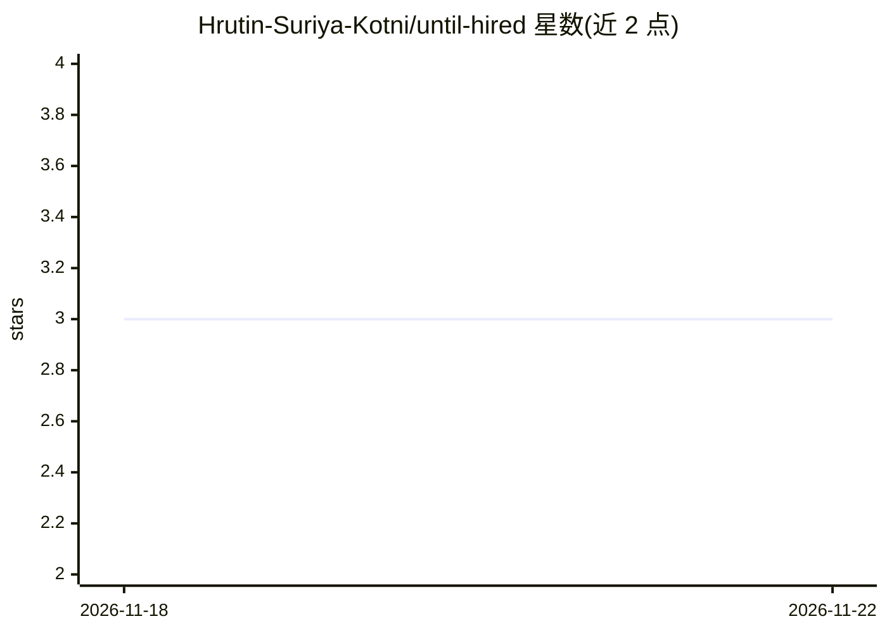

# Hrutin-Suriya-Kotni/until-hired

⭐ 3 · Python · MIT · 推送 2026-11-13 · [GitHub](https://github.com/Hrutin-Suriya-Kotni/until-hired) · 个人维护

**求职全流程 AI 教练 Agent Skills：从摸底到入职跟踪**

一组面向 Claude Code、Claude 应用、Google Antigravity 等 agent 的 Agent Skills 集合，覆盖求职全流程：先进行 60–90 分钟摸底访谈建立经证实的事实档案，之后按用户选择的平台与自动化程度发现并打分职位、生成基于事实的简历与申请草稿、用 CSV 文件跟踪每一份申请与面试、汇总市场地图与技能差距报告。强调诚实原则：不编造经历、不代管密码、消息均为用户亲自发送的草稿。数据全部保存在用户本地文件夹。

## 筛选速览

| 维度 | 判定 | 备注 |
|---|---|---|
| AI 角色 | `ai-native` | 本体是模型或模型工具 |
| 许可风险 | `permissive` | MIT |
| 部署形态 | `None` |  |
| 模型依赖 | — | README 未给出锁定关系 |
| 硬件要求 | — | 无带数字的原话,不猜 |
| 安装摩擦 | `low` | 无编译、无系统依赖或容器化 |
| 成熟度 | `idea` | |

## 能力要点

- 13 个技能模块覆盖摸底、职位发现、申请、面试、谈 offer 全流程
- 事实先行机制：所有输出仅来自经证实的 FACTS 文件，并记录 DO_NOT_CLAIM
- CSV 漏斗跟踪：按来源统计申请-回复-面试转化
- 按 agent 能力（并行子代理、浏览器工具）推荐 team/sequential/solo 模式

## 适用场景

- 让 AI agent 帮我筛选打分职位并起草申请材料
- 用漏斗数据找出哪种投递渠道真正带来面试
- 面试后做复盘，生成该学什么的差距报告

## 场景标签

 · 领域:职业/求职工具

## 证据(README 行号)

> L8: until-hired is a set of Agent Skills for AI agents such as Claude Code, the Claude app and Google Antigravity. It is
> L62: |`until-hired`|Entry point. Routes to setup and intake, runs the daily session and the weekly review, and keeps goi

## 星数曲线

2026-11-18 3 → 2026-11-22 3（+0）

---
*卡片 v1 · prompt 1.4 · 生成 2026-11-22 · 置信度 high · 依据 README sha `aa9612d1f84a` · [字段定义](../../DATASET.md)*
