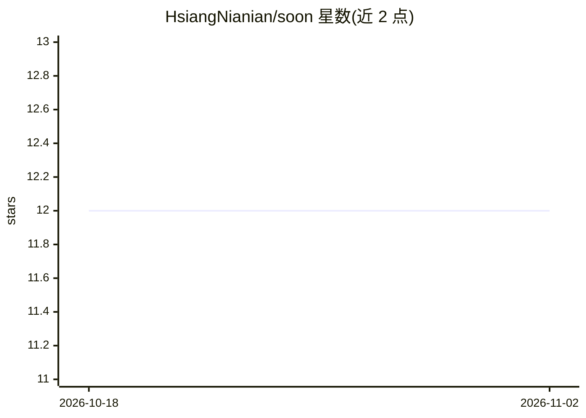

# HsiangNianian/soon

⭐ 12 · Rust · MIT · 推送 2026-07-30 · [GitHub](https://github.com/HsiangNianian/soon) · [官网](https://soon.hydroroll.team) · 个人维护

**本地优先的终端 agent：预测并修复你的下一条完整命令**

Rust 编写的命令预测工具：读取本地 shell 历史，基于命令转移、目录、频率、新近度等证据做确定性排序，在空提示符处以暗色幽灵建议渲染一条完整命令，Ctrl-F 接受后仍需用户自行确认执行。成功后触发 Next-step、失败后触发 Repair，也可显式运行 soon 按需预测。可选启用 OpenAI 兼容端点做重排/修复/生成，默认 model_mode 为 off、无需网络。交互式集成仅支持 Linux/macOS 的 Zsh，其他 shell 仅支持历史解析；项目自述为 Beta 状态。

## 筛选速览

| 维度 | 判定 | 备注 |
|---|---|---|
| AI 角色 | `ai-native` | 本体是模型或模型工具 |
| 许可风险 | `permissive` | MIT |
| 部署形态 | `library` | 以包/库形式分发 |
| 模型依赖 | — | README 未给出锁定关系 |
| 硬件要求 | — | 无带数字的原话,不猜 |
| 安装摩擦 | `low` | 无编译、无系统依赖或容器化 |
| 成熟度 | `idea` | |

## 能力要点

- 默认路径纯本地历史驱动，20ms Zsh p95 预算的确定性预测
- 失败命令后自动给出 Repair 建议，Ctrl-F 接受、用户决定执行
- 可选 OpenAI 兼容端点做 Rerank/Repair/Generate，默认关闭且超时回退
- 敏感命令过滤：拒绝疑似 API key/token/密码等凭据入库

## 适用场景

- 重复工作流中让终端预填下一条完整命令
- 命令失败后快速获得修复建议
- 在不联网的前提下获得命令预测

## 场景标签

 · 领域:开发者工具/终端

## 证据(README 行号)

> L5: A local-first terminal agent that predicts, repairs, and suggests your next full command.
> L37: The default prediction path uses local history, not a model or network service. It can choose a Next-step suggestio
> L47: 1. Observe the completed command and its result.

## 星数曲线

2026-10-18 12 → 2026-11-02 12（+0）

---
*卡片 v1 · prompt 1.4 · 生成 2026-11-01 · 置信度 high · 依据 README sha `f6137e6d91d9` · [字段定义](../../DATASET.md)*
