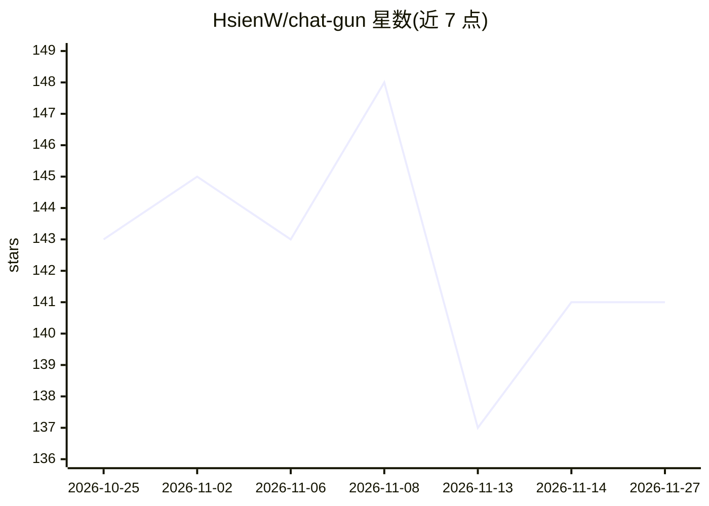

# HsienW/chat-gun

⭐ 141 · TypeScript · NOASSERTION · 推送 2026-11-21 · [GitHub](https://github.com/HsienW/chat-gun) · 个人维护 · 中文 README

**开发者用的全栈 Agent 应用：治理机制完备的对话与客服演示**

由 Frontend、BFF 与 LangGraph Runtime 组成的全端 Agent 应用，含 Agent 平台层与业务场景层。平台提供五个共用 Runtime 的 Graph（研究、对话、购物、算式、MCP）、流式输出、图片多模态输入、人工核准（HITL）、幂等键副作用控制与 OpenTelemetry/Opik 观测。业务场景 Gun Shop 为一条带引用检索、证据门槛拒答、退款人工核准的模拟客服链路，订单工具为模拟，不触真实交易。默认仅本地开发部署。

## 筛选速览

| 维度 | 判定 | 备注 |
|---|---|---|
| AI 角色 | `ai-native` | 本体是模型或模型工具 |
| 许可风险 | `none` | NOASSERTION |
| 部署形态 | `self-host` | docker 或自建部署 |
| 模型依赖 | — | README 未给出锁定关系 |
| 硬件要求 | — | 无带数字的原话,不猜 |
| 安装摩擦 | `low` | 无编译、无系统依赖或容器化 |
| 成熟度 | — | 结构信号不足 |

## 能力要点

- 五个共用 Runtime 的 Graph：Deep Researcher、Chat Assistant、Shopping Assistant、Math Solver、MCP Agent
- 副作用治理：工具呼叫先经人工核准，幂等键保证重复提交只生效一次
- 带引用的 RAG：PostgreSQL + pgvector，经 qwen3-rerank 与证据门槛后拒答无依据问题
- 提供 OpenTelemetry 与 Opik tracing，以及 deterministic/live 两层评测

## 适用场景

- 体验带人工核准与幂等控制的 Agent 副作用执行流程
- 搭建带引用溯源与拒答机制的知识库客服
- 本地运行多 Graph Agent 应用并接入 MCP 工具

## 场景标签

`聊天机器人` `RAG` · 领域:对话与助手

## 证据(README 行号)

> L34: Chat Gun 是一套由 Frontend、BFF 與 LangGraph Runtime 組成的全端 Agent 應用。
> L36: - AI 業務場景：是上層功能，建立在平台能力之上，目前有兩個入口 **Gun Chat** 處理一般對話與深度研究，**Gun Shop** 是一條從商品查詢、政策問答到退款核准的 AI 智能客服鏈路。
> L63: - **Multimodal input**：接受 PNG、JPEG 與 WebP 圖片，經 vision model 分析後納入回答或研究流程。

## 星数曲线

2026-10-25 143 → 2026-11-27 141（-2）

---
*卡片 v1 · prompt 1.4 · 生成 2026-11-27 · 置信度 mid · 依据 README sha `b37653eba1c7` · [字段定义](../../DATASET.md)*
