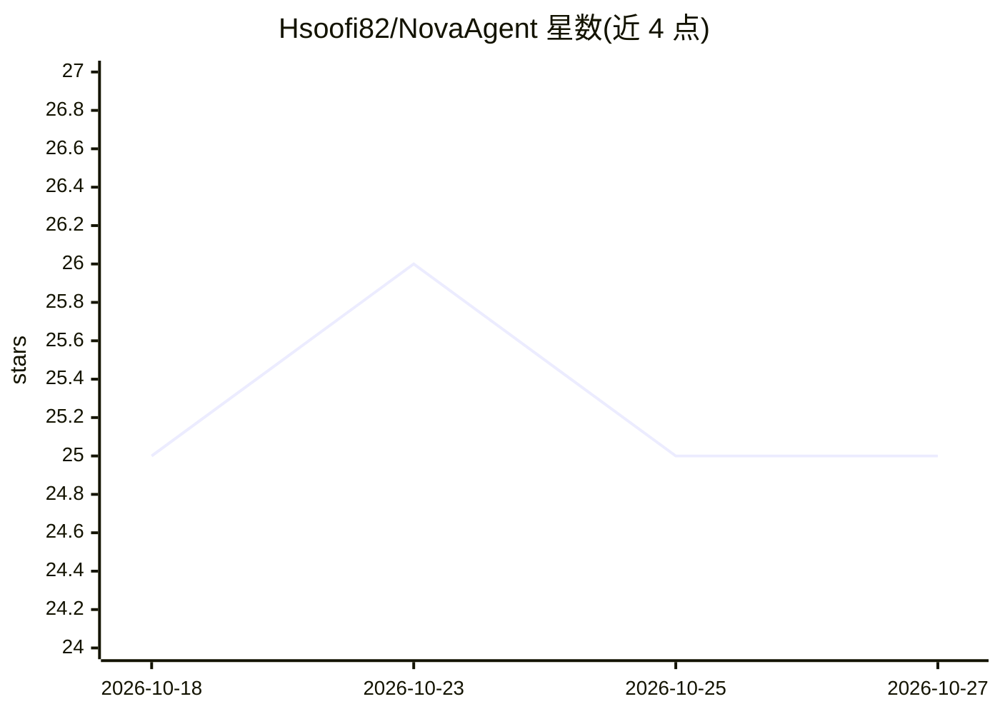

# Hsoofi82/NovaAgent

⭐ 25 · TypeScript · AGPL-3.0 · 推送 2026-10-13 · [GitHub](https://github.com/Hsoofi82/NovaAgent) · 个人维护 · 中文 README

**自托管的 Telegram AI Agent 平台，运行于 Cloudflare Workers**

基于 Cloudflare Workers 的 Telegram AI Agent 平台，以 Google Gemini 为推理与函数调用引擎，Cloudflare AI/Flux 生成图像，Cloudflare D1 存储数据。单个 agent 可选择并链式调用工具完成多步任务：网络搜索、读网页、生成与公开托管单文件 HTML 应用和 HTML5 游戏、生成 RTL 兼容 PDF、语音回复。支持短长期记忆、群组感知、Telegram Business 自动回复、Mini App 面板与管理控制中心。需自备 Cloudflare 账号、Telegram Bot Token 与 Gemini API key，仅三个环境变量必填，免费层可运行。

## 筛选速览

| 维度 | 判定 | 备注 |
|---|---|---|
| AI 角色 | `ai-native` | 本体是模型或模型工具 |
| 许可风险 | `viral` | AGPL-3.0 |
| 部署形态 | `library` | 以包/库形式分发 |
| 模型依赖 | — | README 未给出锁定关系 |
| 硬件要求 | — | 无带数字的原话,不猜 |
| 安装摩擦 | `low` | 无编译、无系统依赖或容器化 |
| 成熟度 | — | 结构信号不足 |

## 能力要点

- Gemini 驱动的推理、函数调用与多步工具链编排
- 生成并公开托管单文件 HTML 应用与 HTML5 游戏
- 短/长期记忆、群组感知与用户画像
- Telegram Mini App 面板与 Nova 控制中心（用户/群组/诊断管理）

## 适用场景

- 在 Telegram 中通过对话让 agent 搜索、建站并托管分享链接
- 自托管一个能生成图像、PDF 与语音回复的群组 AI 助手
- 为 Telegram Business 连接配置自动私信回复

## 场景标签

`AI 助手` `图像生成` `语音合成` · 领域:对话与助手

## 证据(README 行号)

> L22: Nova is a self-hostable **AI Agent Platform for Telegram**, designed to combine conversational AI, persistent memor
> L24: Nova uses **Google Gemini** as its primary reasoning and function-calling engine, **Cloudflare AI / Flux** for imag
> L40: * Gemini-based reasoning

## 星数曲线

2026-10-18 25 → 2026-10-27 25（+0）

---
*卡片 v1 · prompt 1.4 · 生成 2026-10-27 · 置信度 high · 依据 README sha `7f6ad02e893c` · [字段定义](../../DATASET.md)*
