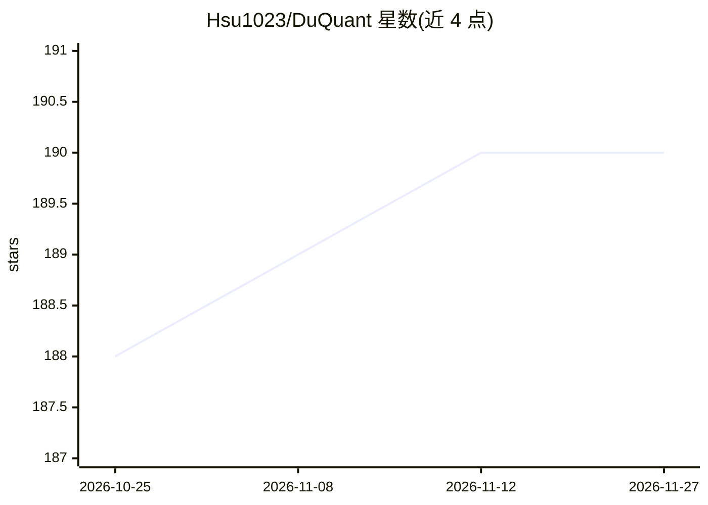

# Hsu1023/DuQuant

⭐ 190 · Python · MIT · 推送 2026-11-26 · [GitHub](https://github.com/Hsu1023/DuQuant) · [官网](https://arxiv.org/abs/2406.01721) · 组织维护 · 中文 README

**LLM 4比特权重激活量化的算法实现库（NeurIPS 2024 Oral 论文代码）**

论文 DuQuant 的官方代码：通过旋转与置换双重变换消除 LLM 中的离群值，实现 W4A4 甚至 W4A4KV4 的训练后量化，覆盖 LLaMA 1/2/3、Vicuna、Mistral 系列。工作流包含预处理（生成旋转矩阵与激活缩放）、量化（支持 GPTQ 导出与 LWC 可学习裁剪）和评测（PPL、zero-shot 任务、MMLU、MT-Bench）。另提供面向 Ada（SM89）与 Hopper（SM90）的 CUDA INT4 推理后端，含 INT4 GEMM/GEMV 与 KV4 缓存。需 conda 环境与 CUDA GPU。

## 筛选速览

| 维度 | 判定 | 备注 |
|---|---|---|
| AI 角色 | `ai-native` | 本体是模型或模型工具 |
| 许可风险 | `permissive` | MIT |
| 部署形态 | `library` | 以包/库形式分发 |
| 模型依赖 | — | README 未给出锁定关系 |
| 硬件要求 | — | 无带数字的原话,不猜 |
| 安装摩擦 | `medium` | 含编译或系统依赖之一 |
| 成熟度 | — | 结构信号不足 |

## 能力要点

- 旋转+置换双重变换消除 down_proj 层大规模离群值
- Ada 与 Hopper 两种 CUDA INT4 推理后端，含打包 KV4 缓存
- 支持 LLaMA 1/2/3、Vicuna、Mistral 的量化模型库
- 量化后可评测 PPL、七个 zero-shot 任务、MMLU 与 MT-Bench

## 适用场景

- 在消费级 GPU 上以 4 比特量化运行并评测 LLaMA 类模型
- 复现论文的 W4A4 量化对比实验
- 为自有模型生成校准后的量化检查点并做 INT4 推理

## 场景标签

`模型量化` `模型评测` · 领域:评测与运维

## 证据(README 行号)

> L9: Welcome to the official code repository for "DuQuant: Distributing Outliers via Dual Transformation Makes Stronger Q
> L23: - DuQuant proposes to use **Rotation transformation** and **Permutation transformation** to effectively eliminate b
> L28: We implement an Ada (SM89) CUDA backend for DuQuant, including calibrated dual rotations and permutations, packed I

## 星数曲线

2026-10-25 188 → 2026-11-27 190（+2）

---
*卡片 v1 · prompt 1.4 · 生成 2026-11-26 · 置信度 high · 依据 README sha `fdfbceae1760` · [字段定义](../../DATASET.md)*
