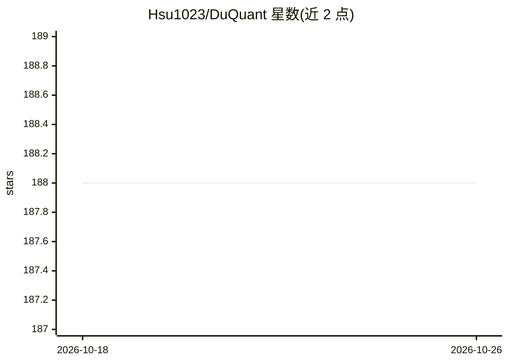

# Hsu1023/DuQuant

⭐ 188 · Python · MIT · 推送 2026-04-24 · [GitHub](https://github.com/Hsu1023/DuQuant) · [官网](https://arxiv.org/abs/2406.01721) · 组织维护

**LLM 训练后量化方法：用旋转与置换变换消除离群值**

NeurIPS 2024 Oral 论文 DuQuant 的官方代码仓库，面向 LLM 的 4-bit 权重-激活训练后量化。方法基于两项观察与机制：识别 FFN 模块 down_proj 层的 massive outliers，用 Rotation 与 Permutation 双变换分散并消除离群值，另提供可学习权重裁剪（LWC）选项。支持 LLaMA 1/2/3、Vicuna、Mistral 系列模型，提供困惑度、zero-shot、MMLU、MT-Bench 评测入口。以 conda + pip 依赖方式从源码运行，新版本 DuQuant++ 支持 MXFP4 格式。

## 筛选速览

| 维度 | 判定 | 备注 |
|---|---|---|
| AI 角色 | `ai-ecosystem` | LLM/agent 周边工具 |
| 许可风险 | `permissive` | MIT |
| 部署形态 | `library` | 以包/库形式分发 |
| 模型依赖 | — | README 未给出锁定关系 |
| 硬件要求 | — | 无带数字的原话,不猜 |
| 安装摩擦 | `low` | 无编译、无系统依赖或容器化 |
| 成熟度 | — | 结构信号不足 |

## 能力要点

- 旋转与置换双变换消除 massive/normal outliers
- W4A4 权重-激活量化，支持 LWC 可学习权重裁剪
- 支持 LLaMA 1/2/3、Vicuna、Mistral 系列（7B 至 70B）
- DuQuant++ 扩展支持 MXFP4 量化格式

## 适用场景

- 研究者在本地对 LLaMA/Vicuna/Mistral 做 4-bit 量化实验
- 评测量化模型在 PPL/MMLU/MT-Bench 上的表现
- 探索更低比特（W4A4、MXFP4）的 LLM 部署方案

## 场景标签

`模型量化` · 领域:训练与推理

## 证据(README 行号)

> L22: - We firstly identify **Massive Outliers** existence at the **down_proj** layer of FFN module in recent LLMs.
> L23: - DuQuant proposes to use **Rotation transformation** and **Permutation transformation** to effectively eliminate b
> L46: - `--model`: the local model path or huggingface format.

## 星数曲线

2026-10-18 188 → 2026-10-26 188（+0）

---
*卡片 v1 · prompt 1.4 · 生成 2026-10-23 · 置信度 mid · 依据 README sha `462aa5c07b23` · [字段定义](../../DATASET.md)*
