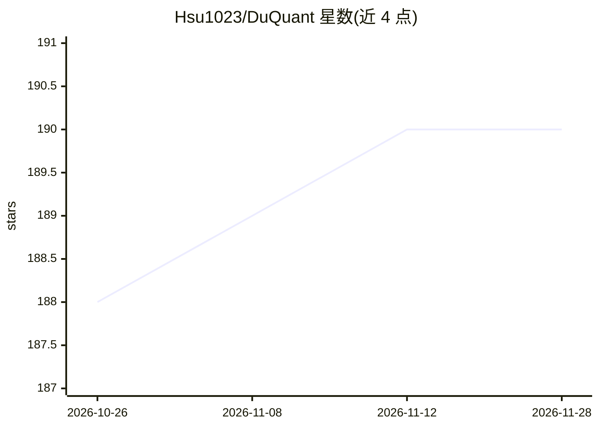

# Hsu1023/DuQuant

⭐ 190 · Python · MIT · 推送 2026-11-26 · [GitHub](https://github.com/Hsu1023/DuQuant) · [官网](https://arxiv.org/abs/2406.01721) · 组织维护

**面向研究者的 LLM 4-bit 权重-激活量化代码库**

NeurIPS 2024 Oral 论文 DuQuant 的官方实现，通过旋转与置换双重变换消除 LLM 中的激活离群值，执行 W4A4/KV4 后训练量化。流程包含预处理（生成旋转矩阵与激活尺度）、量化（RTN/GPTQ、可选 LWC）与评估（PPL、zero-shot 任务、MMLU、MT-Bench）。提供 Ada/Ampere/Hopper 三个 CUDA INT4 推理后端。安装需 conda 环境、git clone 与 pip 安装 requirements.txt；量化模型支持 LLaMA 1/2/3、Vicuna、Mistral 系列。

## 筛选速览

| 维度 | 判定 | 备注 |
|---|---|---|
| AI 角色 | `ai-native` | 本体是模型或模型工具 |
| 许可风险 | `permissive` | MIT |
| 部署形态 | `library` | 以包/库形式分发 |
| 模型依赖 | — | README 未给出锁定关系 |
| 硬件要求 | — | 无带数字的原话,不猜 |
| 安装摩擦 | `medium` | 含编译或系统依赖之一 |
| 成熟度 | — | 结构信号不足 |

## 能力要点

- 旋转+置换双重变换消除 FFN down_proj 层离群值，输出量化模型
- 提供 Ada/Ampere/Hopper 三个 INT4 CUDA 推理后端，自动选择
- 支持 RTN/GPTQ 导出与 LWC 可学习权重裁剪训练
- 评估覆盖 PPL、7 项 zero-shot 任务、MMLU 与 MT-Bench

## 适用场景

- 把 LLaMA/Mistral 系列模型量化到 4 bit 并评估精度损失
- 在 RTX 4090/A100/GH200 上跑打包 INT4 权重与 KV cache 推理
- 复现论文的量化基线对比实验

## 场景标签

`模型量化` `推理引擎` · 领域:训练与推理

## 证据(README 行号)

> L24: - DuQuant proposes to use **Rotation transformation** and **Permutation transformation** to effectively eliminate b
> L95: ## 🔧 Installation
> L136: Currently, we support LLaMA series (LLaMA 1, 2 and 3), Vicuna series, and Mistral models.

## 星数曲线

2026-10-26 188 → 2026-11-28 190（+2）

---
*卡片 v1 · prompt 1.4 · 生成 2026-11-27 · 置信度 high · 依据 README sha `17e653a7b571` · [字段定义](../../DATASET.md)*
