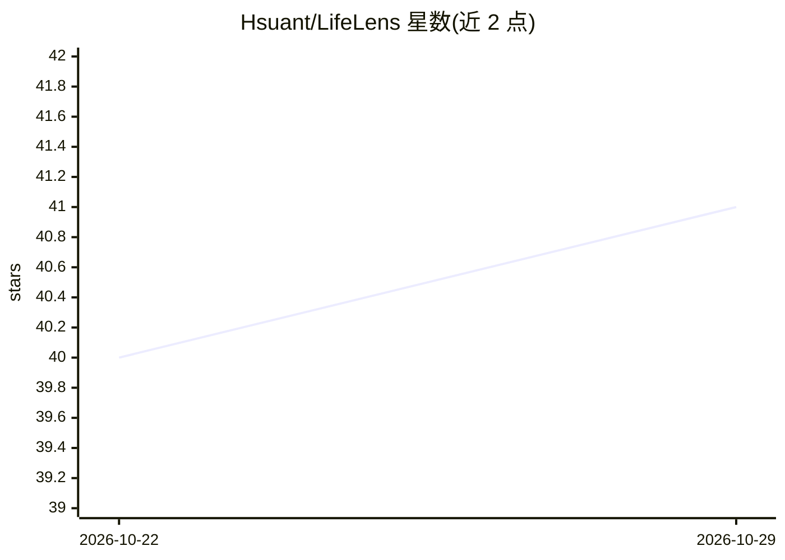

# Hsuant/LifeLens

⭐ 41 · Python · NOASSERTION · 推送 2026-10-25 · [GitHub](https://github.com/Hsuant/LifeLens) · 个人维护 · 中文 README

**爬取携程/去哪儿景点与评论并提供分析的 Python 工具**

面向旅游数据的爬虫项目：以携程与去哪儿为已接入平台，按 list→detail→comments 流水线采集景点列表、详情与用户评论，支持按景点名/城市名/POI ID/地区 ID 四种入口，ID 自动解析；带断点续跑（进度 JSON 与失败页记录）、随机延迟与退避重试、统一配置与 JSON/CSV 存储，评论 CSV 为 utf-8-sig 可直接用 Excel 打开。核心依赖仅 requests 与 beautifulsoup4，提供 105 个离线单测。情感分析、词云、地理热图等机器学习分析层为待实现的占位模块；美团平台与代理轮换尚未接入。项目采用 CC BY-NC 4.0 许可，README 明确禁止商业用途并要求合规采集。

## 筛选速览

| 维度 | 判定 | 备注 |
|---|---|---|
| AI 角色 | `ai-enhanced` | 去掉 AI 部分产品仍成立 |
| 许可风险 | `none` | NOASSERTION |
| 部署形态 | `desktop` | 安装包/桌面程序 |
| 模型依赖 | — | README 未给出锁定关系 |
| 硬件要求 | — | 无带数字的原话,不猜 |
| 安装摩擦 | `low` | 无编译、无系统依赖或容器化 |
| 成熟度 | `idea` | |

## 能力要点

- list→detail→comments 一键流水线，支持 sight/city/poi_id/district_id 四种目标
- 断点续跑：景点级与评论按页 checkpoint，失败页单独记录
- 评论 CSV 采用 utf-8-sig 编码，字段覆盖评分、内容、时间等 19 列
- 核心单测 mock 网络请求，离线基线 105 passed

## 适用场景

- 采集某城市全部景点的详情与用户评论做数据分析练习
- 按景点名单点采集，如“黄鹤楼”的全部评论
- 中断后续跑补采，并定位失败页面

## 场景标签

`网页抓取` · 领域:效率与自动化

## 证据(README 行号)

> L15: - **全链路采集**：携程与去哪儿景点列表、详情、评论一站式爬取
> L26: - **分析层**：情感分析、词云、地理热图（占位模块与依赖已就位）
> L33: - Python >= 3.9

## 星数曲线

2026-10-22 40 → 2026-10-29 41（+1）

---
*卡片 v1 · prompt 1.4 · 生成 2026-10-25 · 置信度 high · 依据 README sha `2f933284f9c1` · [字段定义](../../DATASET.md)*
