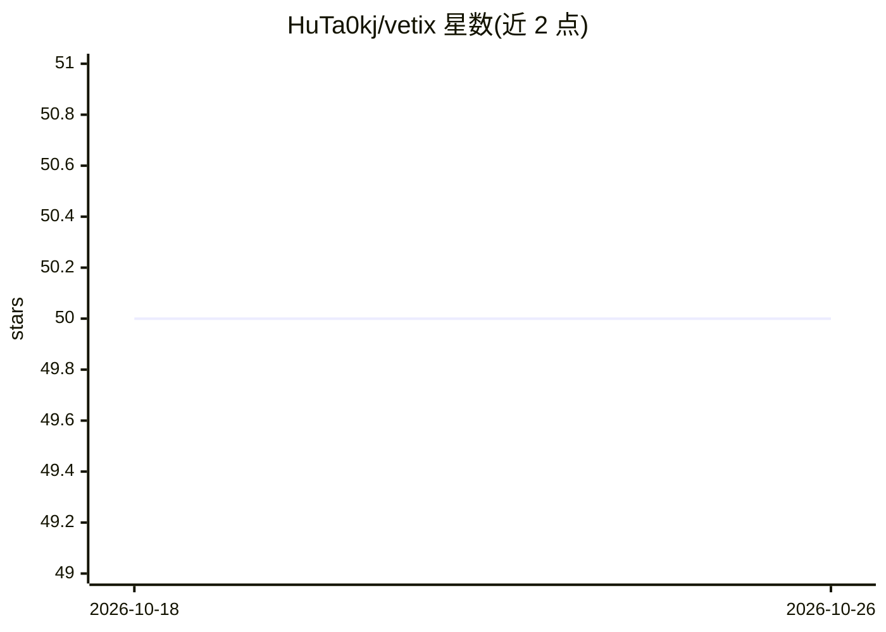

# HuTa0kj/vetix

⭐ 50 · Go · MIT · 推送 2026-09-29 · [GitHub](https://github.com/HuTa0kj/vetix) · 个人维护 · 中文 README

**扫描 agent SKILL 目录安全风险的 LLM-agent 安全扫描器**

基于 Golang 的 SKILL 目录安全扫描器：插件静态规则先做确定性检测，LLM 交叉验证插件命中以控制误报，再由行为分析 agent 在只读虚拟文件系统中追踪“指令→工具调用→主机影响”完整链路，覆盖 10 类风险（远程执行、数据外传、持久化、混淆、提权、提示注入等）。内置 16 个插件，支持二进制、源码构建与 Docker 部署，报告按目录哈希与引擎指纹双层缓存，并记录每次扫描的 token 用量。需在 config.yaml 中配置两个 LLM（lite 验证模型与 pro 推理模型）。

## 筛选速览

| 维度 | 判定 | 备注 |
|---|---|---|
| AI 角色 | `ai-ecosystem` | LLM/agent 周边工具 |
| 许可风险 | `permissive` | MIT |
| 部署形态 | `self-host` | docker 或自建部署 |
| 模型依赖 | — | README 未给出锁定关系 |
| 硬件要求 | — | 无带数字的原话,不猜 |
| 安装摩擦 | `low` | 无编译、无系统依赖或容器化 |
| 成熟度 | — | 结构信号不足 |

## 能力要点

- 插件静态规则 + LLM 交叉验证 + 行为分析 agent 三层扫描
- 只读沙箱：拒绝符号链接、所有写操作在后端被拒、隐藏可变更工具
- 10 类风险分类与 16 个内置插件（Base64 执行、反弹 shell、typosquatting、Unicode 混淆等）
- 报告缓存（目录哈希+引擎指纹）与 token 用量核算

## 适用场景

- 安装第三方 SKILL 前审计其是否含恶意行为或提示注入
- 批量扫描 SKILL 仓库并估算模型调用成本
- 对规则难命中的混淆载荷与多步攻击链做行为级分析

## 场景标签

`网络安全` · 领域:学习与行业

## 证据(README 行号)

> L3: An LLM-agent-based scanner for SKILL directories. Vetix pairs deterministic plugin rules with an LLM behavioral anal
> L13: - **LLM cross-validation** — every plugin hit is re-judged against the real file content by an LLM, so high-recall 
> L14: - **Behavioral analysis agent** — inside a read-only virtual filesystem, traces the full chain "instruction → tool 

## 星数曲线

2026-10-18 50 → 2026-10-26 50（+0）

---
*卡片 v1 · prompt 1.4 · 生成 2026-10-24 · 置信度 mid · 依据 README sha `e1e63e4bd140` · [字段定义](../../DATASET.md)*
