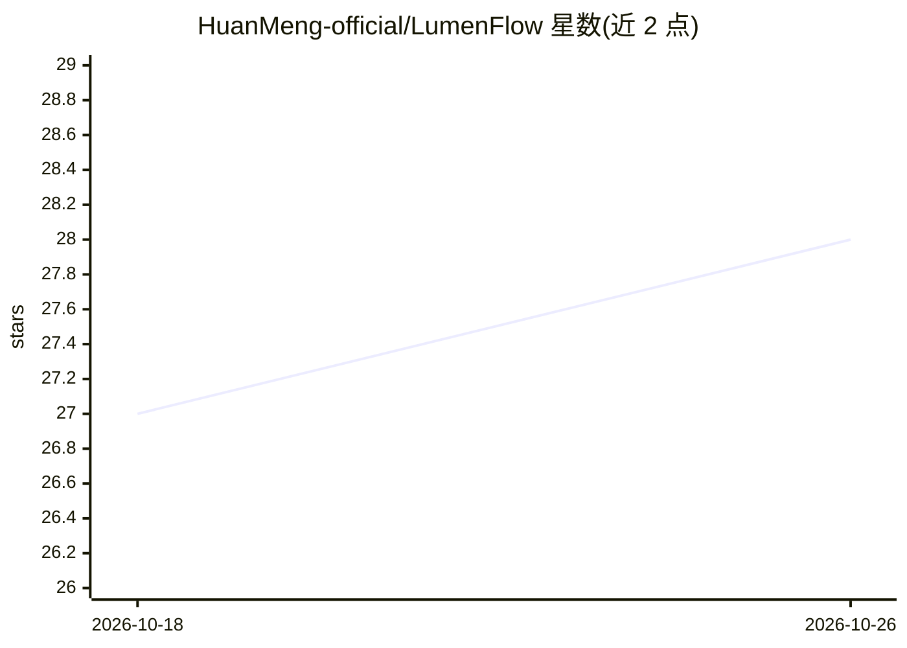

# HuanMeng-official/LumenFlow

⭐ 28 · Dart · MIT · 推送 2026-10-24 · [GitHub](https://github.com/HuanMeng-official/LumenFlow) · 个人维护 · 中文 README

**跨平台 AI 聊天客户端：聚合 12+ AI 平台与本地对话管理**

基于 Flutter 构建的 AI 聊天应用，运行于 Android、Windows、Linux。通过 Provider 抽象层接入 OpenAI、Claude、Gemini、DeepSeek、Kimi、Grok、OpenRouter、LM-Studio（本地部署）及自定义 OpenAI 兼容端点等 12+ 平台，支持同时配置多平台并切换、流式输出、思考过程可视化。数据以 SQLite 本地持久化，提供对话管理、多模态附件、TXT/JSON/PDF 导出导入、角色卡生成器与提示词预设。使用前需自行配置平台 API key。

## 筛选速览

| 维度 | 判定 | 备注 |
|---|---|---|
| AI 角色 | `ai-native` | 本体是模型或模型工具 |
| 许可风险 | `permissive` | MIT |
| 部署形态 | `None` |  |
| 模型依赖 | locked-api |  |
| 硬件要求 | — | 无带数字的原话,不猜 |
| 安装摩擦 | `low` | 无编译、无系统依赖或容器化 |
| 成熟度 | — | 结构信号不足 |

## 能力要点

- Provider 模式接入 12+ AI 平台，含 LM-Studio 本地部署与自定义 OpenAI 兼容端点
- 多平台同时配置与会话中切换，各平台独立模型列表与参数
- SQLite 本地持久化，支持 SharedPreferences 自动迁移与 ACID 事务
- 多模态（图像/视频/音频）附件处理与 TXT/JSON/PDF 导出导入

## 适用场景

- 在同一应用中使用多家 AI 服务商进行对话
- 接入本地 LM-Studio 模型进行离线聊天
- 管理多套角色扮演预设与对话历史并导出备份

## 场景标签

`聊天机器人` · 领域:对话与助手

## 证据(README 行号)

> L9: LumenFlow (Chinese: 流光) is a modern AI chat application built with Flutter that provides a seamless conversational e
> L18: - **12+ AI Platform Support**: OpenAI, Claude, Google Gemini, DeepSeek, SiliconFlow, MiniMax, Zhipu AI, Kimi, LM-St

## 星数曲线

2026-10-18 27 → 2026-10-26 28（+1）

---
*卡片 v1 · prompt 1.4 · 生成 2026-10-26 · 置信度 high · 依据 README sha `6513f34979ee` · [字段定义](../../DATASET.md)*
