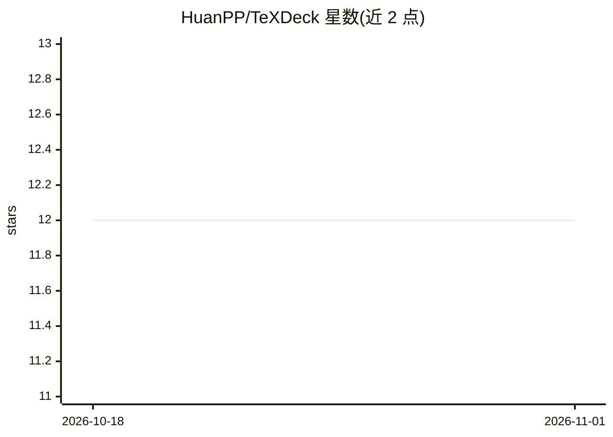

# HuanPP/TeXDeck

⭐ 12 · TeX · MIT · 推送 2026-07-26 · [GitHub](https://github.com/HuanPP/TeXDeck) · 个人维护 · 中文 README

**把 PDF 论文自动生成 LaTeX Beamer 幻灯片的应用**

面向需要做学术演示的用户：上传论文 PDF（最多 10 个文件、合计 200 页）或粘贴文本，由视觉模型逐页读取页面图像，按所选模板生成完整 main.tex，再经 XeLaTeX 编译为 PDF 幻灯片，约 30-60 秒产出 PDF、.tex 源码及可直接导入 Overleaf 的 zip。内置 7 套模板，模板中的 main.tex 本身即是提示词，模型模仿其示例布局生成；提供单页编辑与全稿修改，失败时返回真实错误、无降级输出。支持任意 OpenAI 兼容端点，推荐 Gemini，亦兼容 Moonshot Kimi 视觉模型；文本模型与 kimi-k2.6/k3 系列不可用。

## 筛选速览

| 维度 | 判定 | 备注 |
|---|---|---|
| AI 角色 | `ai-native` | 本体是模型或模型工具 |
| 许可风险 | `permissive` | MIT |
| 部署形态 | `library` | 以包/库形式分发 |
| 模型依赖 | — | README 未给出锁定关系 |
| 硬件要求 | — | 无带数字的原话,不猜 |
| 安装摩擦 | `low` | 无编译、无系统依赖或容器化 |
| 成熟度 | — | 结构信号不足 |

## 能力要点

- 视觉模型逐页读取 PDF 页面图像，按模板生成 main.tex 并用 XeLaTeX 编译
- 模板文件即提示词：模型模仿模板中的完整示例幻灯片生成
- 7 套内置模板（collegeBeamer 衍生 5 套 + SimplePlus + Execushares），均支持中文
- 单页编辑（经 synctex 定位）与全稿指令修改，编译失败自动回滚

## 适用场景

- 把论文快速转成组会或学术会议的 Beamer 幻灯片
- 把季度报告等 PDF 文档整理成演示文稿
- 导出 .tex 与 zip 直接放入 Overleaf 继续编辑

## 场景标签

 · 领域:学术工具/文档生成

## 证据(README 行号)

> L5:  TeXDeck — point it at a PDF, get back a finished Beamer deck
> L13: You upload a paper — or several PDFs that read in order as one pack — or just paste text, pick a template, and a vi
> L58: You need Python 3.12+, Node 20+, a TeX Live install with XeLaTeX (`synctex` too, if you want per-slide editing), an

## 星数曲线

2026-10-18 12 → 2026-11-01 12（+0）

---
*卡片 v1 · prompt 1.4 · 生成 2026-11-01 · 置信度 high · 依据 README sha `4026af726cea` · [字段定义](../../DATASET.md)*
