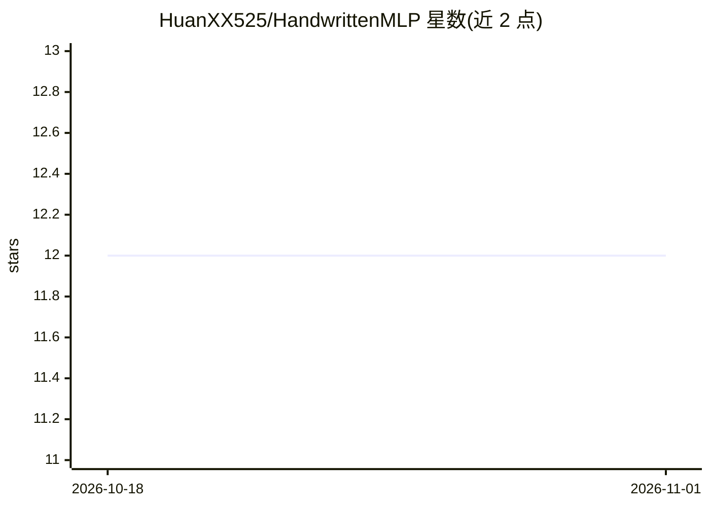

# HuanXX525/HandwrittenMLP

⭐ 12 · Python · 推送 2025-12-19 · [GitHub](https://github.com/HuanXX525/HandwrittenMLP) · 个人维护 · 中文 README

**纯 NumPy 手写 MLP 框架：课程作业实现前向/反向传播与三种优化器**

面向深度学习课程作业的手动实现多层感知机项目：不依赖 PyTorch 等高层 API，仅用 NumPy 构建计算图与自动微分（Value 类含 data/grad/_backward），实现前向传播、交叉熵损失、链式法则反向传播，以及 SGD/Momentum/Adam 三种优化器，在 MNIST 上训练并比较收敛速度与精度。提供基础版（贴合计算原理）与 Numpy 加速版（向量化、广播、矩阵化层实现）两套实现，通过 python 脚本命令行运行。

## 筛选速览

| 维度 | 判定 | 备注 |
|---|---|---|
| AI 角色 | `ai-native` | 本体是模型或模型工具 |
| 许可风险 | `none` | — |
| 部署形态 | `None` |  |
| 模型依赖 | — | README 未给出锁定关系 |
| 硬件要求 | — | 无带数字的原话,不猜 |
| 安装摩擦 | `low` | 无编译、无系统依赖或容器化 |
| 成熟度 | — | 结构信号不足 |

## 能力要点

- 计算图 + Value 类实现自动微分与手动反向传播
- SGD/Momentum/Adam 三种优化器可命令行切换
- 基础版与 Numpy 向量化加速版双实现
- 在 MNIST 数据集上训练评估

## 适用场景

- 学习手动实现前向/反向传播的计算原理
- 比较不同优化器的收敛速度与训练稳定性
- 理解计算图与自动微分的底层机制

## 场景标签

`教程课程` · 领域:学习与行业

## 证据(README 行号)

> L4: - 实验内容：不使用深度学习框架的高层 API（如 PyTorch 的 nn.Module），仅使用 NumPy，可以使用自动微分库（如 Autograd）但必须理解反向传播原理。在数据集上训练模型，并比较不同优化器的收敛速度、最终
> L28: 本项目手动实现了多层感知机（MLP）的前向传播和反向传播过程，不依赖深度学习框架的高层 API。核心原理包括：

## 星数曲线

2026-10-18 12 → 2026-11-01 12（+0）

---
*卡片 v1 · prompt 1.4 · 生成 2026-11-01 · 置信度 high · 依据 README sha `72cd8c7a39c0` · [字段定义](../../DATASET.md)*
