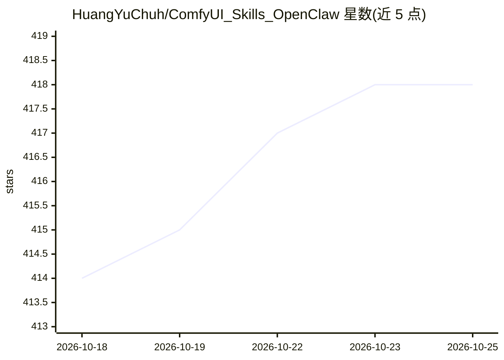

# HuangYuChuh/ComfyUI_Skills_OpenClaw

⭐ 418 · Python · MIT · 推送 2026-08-26 · [GitHub](https://github.com/HuangYuChuh/ComfyUI_Skills_OpenClaw) · [官网](https://huangyuchuh.github.io/ComfyUI_Skills_OpenClaw/) · 个人维护 · 中文 README

**将 ComfyUI 工作流封装为 AI agent 可调用技能的 CLI 桥接层**

面向 OpenClaw、Hermes Agent、Codex、Claude Code 等 agent 的 ComfyUI 桥接工具：导入 ComfyUI API 格式工作流 JSON，通过 schema 映射只暴露指定参数，生成 agent 可经 shell 调用的 CLI（comfyui-skill）命令；支持多服务器命名空间路由、依赖检查与安装、异步提交与历史记录，并可配合官方 Comfy 本地 MCP 做模板/节点/模型发现。附带可选的本地 Web UI（localhost:18189）用于可视配置与测试，界面支持英文与简繁中文。需 Python 3.10+ 与运行中的 ComfyUI 服务器。

## 筛选速览

| 维度 | 判定 | 备注 |
|---|---|---|
| AI 角色 | `ai-ecosystem` | LLM/agent 周边工具 |
| 许可风险 | `permissive` | MIT |
| 部署形态 | `library` | 以包/库形式分发 |
| 模型依赖 | locked-api |  |
| 硬件要求 | — | 无带数字的原话,不猜 |
| 安装摩擦 | `low` | 无编译、无系统依赖或容器化 |
| 成熟度 | — | 结构信号不足 |

## 能力要点

- schema 参数映射：只暴露指定字段供 agent 控制
- comfyui-skill CLI 导入/运行/异步提交 ComfyUI 工作流
- 多本地/远程 ComfyUI 服务器统一命名空间路由
- 执行前检查缺失节点与模型并经 CLI 安装依赖

## 适用场景

- 让 OpenClaw/Claude Code 等 agent 在对话中调用我的 ComfyUI 工作流
- 复用已导出的工作流而不暴露完整图形结构
- 多台机器（本地/远程 GPU）统一管理 ComfyUI 任务路由

## 场景标签

`图像生成` `Agent 框架` · 领域:Agent 开发

## 证据(README 行号)

> L7:  Use this project to turn ComfyUI workflows into callable skills with an agent-friendly CLI as the primary interface
> L34: ComfyUI Skills for OpenClaw is an agent-friendly bridge that turns ComfyUI workflows into callable skills for AI ag
> L63: - Use `comfyui-skill` for registered workflows, repeated execution, batch jobs, uploads, and history.

## 星数曲线

2026-10-18 414 → 2026-10-25 418（+4）

---
*卡片 v1 · prompt 1.4 · 生成 2026-10-21 · 置信度 high · 依据 README sha `0e26fac92dd8` · [字段定义](../../DATASET.md)*
