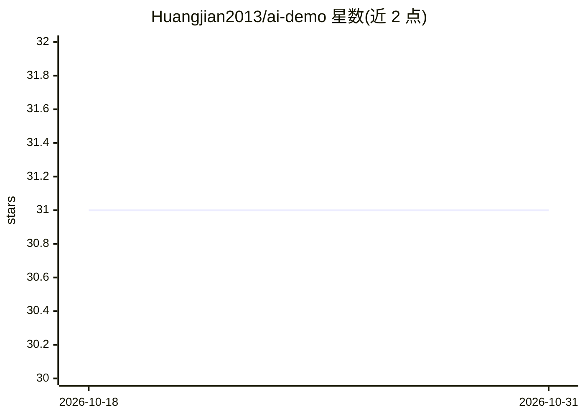

# Huangjian2013/ai-demo

⭐ 31 · Jupyter Notebook · 推送 2026-05-17 · [GitHub](https://github.com/Huangjian2013/ai-demo) · [官网](https://weibo.com/u/5648162302) · 个人维护 · 中文 README

**面向开发者的 AI 技术实战案例与教程集合**

面向希望学习和探索 AI 技术的开发者，提供从 Prompt Engineering、RAG（Embedding、向量数据库 Qdrant、GraphRAG）到 AI Agent（ReAct、Plan-and-Solve 等原生 Python 实现）的代码示例、Jupyter Notebook 教程与学习资料。内容按技术领域模块化组织，含 OpenAI Swarm 框架演示、计算机视觉应用与 Cloudflare 云端部署示例，并收集 LLM/Agent 相关 PDF 电子书，给出建议学习顺序。

## 筛选速览

| 维度 | 判定 | 备注 |
|---|---|---|
| AI 角色 | `ai-knowledge` | 知识聚合/清单类 |
| 许可风险 | `none` | — |
| 部署形态 | `None` |  |
| 模型依赖 | — | README 未给出锁定关系 |
| 硬件要求 | — | 无带数字的原话,不猜 |
| 安装摩擦 | `low` | 无编译、无系统依赖或容器化 |
| 成熟度 | — | 结构信号不足 |

## 能力要点

- RAG 基础/进阶/高阶分层教程（Qdrant、LangChain、LlamaIndex、GraphRAG）
- ReAct、Plan-and-Solve、Reflection 等经典 Agent 架构的原生 Python 实现
- OpenAI Swarm 多智能体框架演示与 Cloudflare 云端部署示例
- 附 LLM/Agent 相关 PDF 报告与电子书资料

## 适用场景

- 按模块系统学习 Prompt、RAG、Agent 等 AI 技术
- 不依赖框架手写 Agent 以理解底层原理
- 查找 LLM 企业级问答方向的实践代码示例

## 场景标签

`教程课程` · 领域:学习与行业

## 证据(README 行号)

> L3: 欢迎来到 AI Demo 项目！这是一个专门为希望学习和探索人工智能（AI）技术的开发者准备的实战案例集合。
> L5: 本项目通过具体的代码示例、Jupyter Notebook 教程和相关资料，帮助你深入理解从 Prompt Engineering 到 RAG（检索增强生成）再到 AI Agent（智能体）的各项核心技术。

## 星数曲线

2026-10-18 31 → 2026-10-31 31（+0）

---
*卡片 v1 · prompt 1.4 · 生成 2026-10-26 · 置信度 high · 依据 README sha `3ff3d06034a5` · [字段定义](../../DATASET.md)*
