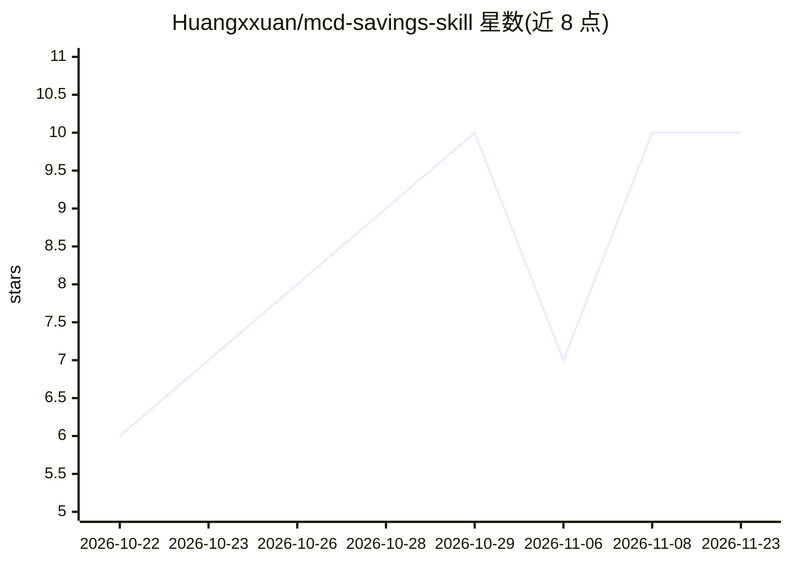

# Huangxxuan/mcd-savings-skill

⭐ 10 · JavaScript · MIT · 推送 2026-10-25 · [GitHub](https://github.com/Huangxxuan/mcd-savings-skill) · [官网](https://huangxxuan.github.io/mcd-savings-skill/) · 个人维护 · 中文 README

**给价格敏感用户的麦当劳点单省钱助手：算最优搭配并领券下单**

基于麦当劳中国 MCP（mcp.mcd.cn）开发的 Skill：将 MCP 返回的菜单、优惠券、营养与门店数据渲染成可交互的 HTML 点单页面，支持省钱榜单（券后最省/官方直降/套餐最优等 5 维度）、预算分档推荐、券自动核价与自动用券、卡路里补全与控卡搭配、外送建档下单。页面数据来自本地快照可离线打开；实时使用需在 MCP Client 中配置 Token 并将 SKILL.md 放入 Skill 目录。营养数据分四档如实标注缺口，不参与的部分明确标示。

## 筛选速览

| 维度 | 判定 | 备注 |
|---|---|---|
| AI 角色 | `ai-native` | 本体是模型或模型工具 |
| 许可风险 | `permissive` | MIT |
| 部署形态 | `None` |  |
| 模型依赖 | — | README 未给出锁定关系 |
| 硬件要求 | — | 无带数字的原话,不猜 |
| 安装摩擦 | `low` | 无编译、无系统依赖或容器化 |
| 成熟度 | — | 结构信号不足 |

## 能力要点

- 基于真实 MCP 返回数据构建可视化点单页，支持离线快照演示
- 省钱榜单与预算分档：本地枚举 2100+ 组合后仅对 Top 3 调 calculate-price 精算
- 逐张调用 calculate-price 验证券的真实可用性，过期/不可用券明确标注
- 35 个 MCP Tool 分 6 组面板展示，可复制指令给任意 Agent 执行

## 适用场景

- 想在预算内吃到最划算的麦当劳套餐
- 管理一堆不会用的优惠券并自动选最优券下单
- 控卡或健身时按热量与蛋白质约束搭配餐品
- 多人拼单时按预算生成整单方案并分账

## 场景标签

 · 领域:生活消费/餐饮工具

## 证据(README 行号)

> L5: 基于 **麦当劳中国 MCP**（`https://mcp.mcd.cn`）能力开发的可交互可视化 Skill。
> L214: - **Skill 层**：`SKILL.md` 定义触发词与九阶段工作流（定位门店/建外送地址 → 领券 → 菜单与营养取数 → 场景搭配 → **省钱榜单** → 确认下单 → **凑单 + 麦麦摇摇乐** → 不错过提醒 

## 星数曲线

2026-10-22 6 → 2026-11-23 10（+4）

---
*卡片 v1 · prompt 1.4 · 生成 2026-11-20 · 置信度 high · 依据 README sha `d34ed88df8fe` · [字段定义](../../DATASET.md)*
