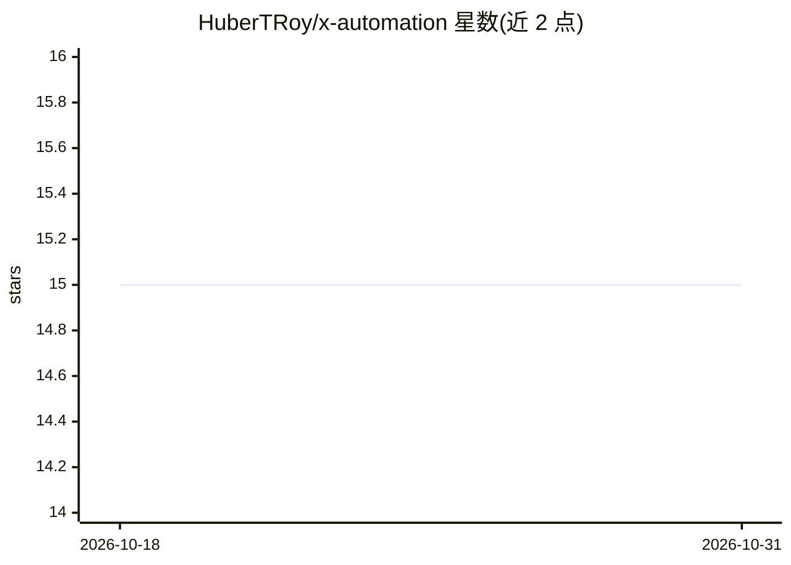

# HuberTRoy/x-automation

⭐ 15 · JavaScript · 推送 2026-09-03 · [GitHub](https://github.com/HuberTRoy/x-automation) · 个人维护 · 中文 README

**面向宿主 Agent 的 X（Twitter）社区互动自动化技能**

以 Skill 形式安装到 Codex、Claude、Hermes 或 OpenClaw 等宿主 Agent 平台的 X（Twitter）自动化工具：通过 Chrome DevTools Protocol 连接已认证浏览器，由宿主 Agent 负责推理与文案生成，本技能提供确定性的采集、回复、转发、引用、发帖与关注操作脚本。流程设有干跑预览、人工授权、来源级验证等多道闸门，推理默认走 agent 模式（退出码 75 暂停等待宿主响应），也支持 external 外部 API 兼容模式。提供一键安装脚本，可选 Telegram 通知。

## 筛选速览

| 维度 | 判定 | 备注 |
|---|---|---|
| AI 角色 | `ai-ecosystem` | LLM/agent 周边工具 |
| 许可风险 | `none` | — |
| 部署形态 | `library` | 以包/库形式分发 |
| 模型依赖 | — | README 未给出锁定关系 |
| 硬件要求 | — | 无带数字的原话,不猜 |
| 安装摩擦 | `low` | 无编译、无系统依赖或容器化 |
| 成熟度 | — | 结构信号不足 |

## 能力要点

- 通过 CDP 连接已认证浏览器执行 X 采集与发布操作
- 干跑预览 + 授权 + 来源级验证的多闸门发布流程
- 推理默认由宿主 Agent 承担（agent 模式），可切换 external 外部 API 模式
- 同一安装包可安装到 Codex/Claude/Hermes/OpenClaw 四个平台

## 适用场景

- 让 Codex 或 Claude 等 Agent 代为运营 X 账号的回复与发帖
- 按自定义关注焦点与风险限制筛选并互动 X 内容
- 通过 Telegram 接收自动化工作流的进度与结果通知

## 场景标签

`浏览器自动化` · 领域:效率与自动化

## 证据(README 行号)

> L24: - Agent boundary: `agent` mode is the default; no separate model is required.
> L139: All generation and selection passes through one `agent_ai.js` method boundary. The invoking agent can produce repl
> L151: The same bundle can be installed for Codex, Claude, Hermes, or OpenClaw. Platform selection is interactive by defa

## 星数曲线

2026-10-18 15 → 2026-10-31 15（+0）

---
*卡片 v1 · prompt 1.4 · 生成 2026-10-30 · 置信度 high · 依据 README sha `f8c0014c7a2e` · [字段定义](../../DATASET.md)*
