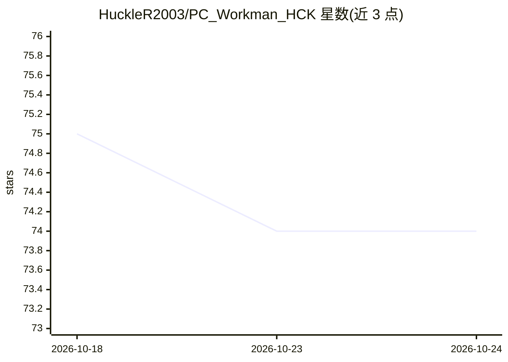

# HuckleR2003/PC_Workman_HCK

⭐ 74 · Python · MIT · 推送 2026-10-09 · [GitHub](https://github.com/HuckleR2003/PC_Workman_HCK) · [官网](https://pcworkman.dev) · 个人维护

**带离线 AI 助手的 Windows 系统监控与优化工具**

单人开发的 Windows 桌面系统监控应用：实时追踪 CPU/GPU/RAM/温度/电压/网络，学习用户本机的工作负载温度基线（Welford 在线累加），对 12V/5V/3.3V 电压轨做 SPC 控制限分析，提供启动项管理、40+ Windows 服务模式配置、驱动健康检查、320 条目离线硬件库的升级兼容判定等。内置 hck_GPT 助手：127 个意图、混合引擎（规则响应 + Ollama LLM 应对开放问题），100% 离线、无 API key，波兰语/英语自动检测。通过 Microsoft Store 或 Releases ZIP 分发，也可从源码运行。

## 筛选速览

| 维度 | 判定 | 备注 |
|---|---|---|
| AI 角色 | `ai-enhanced` | 去掉 AI 部分产品仍成立 |
| 许可风险 | `permissive` | MIT |
| 部署形态 | `desktop` | 安装包/桌面程序 |
| 模型依赖 | local-ok | 支持本地模型 |
| 硬件要求 | — | 无带数字的原话,不猜 |
| 安装摩擦 | `low` | 无编译、无系统依赖或容器化 |
| 成熟度 | — | 结构信号不足 |

## 能力要点

- 按工作负载学习本机温度基线（Welford 在线累加，非固定窗口）
- 电压轨 SPC 分析（Median+MAD，Nelson 规则 1/2/3/5）与异常衰减学习
- hck_GPT 离线助手：127 意图、规则+Ollama 混合引擎、双语、会话记忆
- 320 条目离线硬件库支持升级兼容判定（含芯片集代际陷阱）

## 适用场景

- 监控本机硬件状态并自动推送温度/电压异常告警
- 用自然语言问'我的电脑为什么慢'并获得解释
- 管理启动项与 Windows 服务，配置游戏/节能模式
- 购买硬件前检查与自己主板/芯片集的兼容性

## 场景标签

`AI 助手` · 领域:对话与助手

## 证据(README 行号)

> L26: **127 AI intents. The assistant runs 100% on your machine, no API key, no cloud LLM. Just your PC talking to you.**
> L93: - **Hybrid Engine**: rule-based responses for known intents, Ollama LLM for open-ended questions, 100% offline, no 

## 星数曲线

2026-10-18 75 → 2026-10-24 74（-1）

---
*卡片 v1 · prompt 1.4 · 生成 2026-10-24 · 置信度 mid · 依据 README sha `b5a03b22b035` · [字段定义](../../DATASET.md)*
