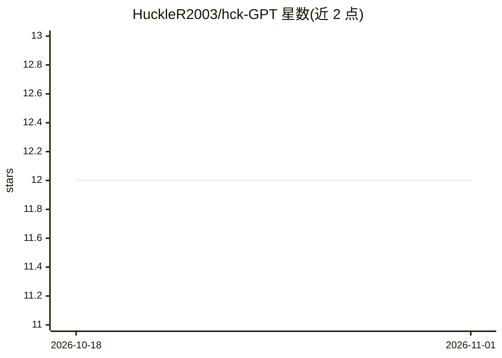

# HuckleR2003/hck-GPT

⭐ 12 · Python · 推送 2026-06-04 · [GitHub](https://github.com/HuckleR2003/hck-GPT) · [官网](https://github.com/HuckleR2003/PC_Workman_HCK) · 个人维护

**Windows 本地 AI 诊断助手：自然语言问答 PC 硬件状态**

面向 Windows 用户的双语（波兰语/英语）PC 诊断助手：以自然语言提问，读取真实硬件数据（CPU/RAM/GPU、进程、温度、驱动、电池）生成回答。核心为混合引擎：82 个内置意图先走确定性规则引擎，低置信或开放性问题路由到本地 Ollama LLM，注入实时系统上下文；Ollama 不可用时 60 秒冷却并回退。另含后台主动监控告警、逐条消息语言检测与波兰语变音归一化。属于 PC Workman HCK 的组成部分，依赖其数据管道，独立 pip 库尚未提供。

## 筛选速览

| 维度 | 判定 | 备注 |
|---|---|---|
| AI 角色 | `ai-native` | 本体是模型或模型工具 |
| 许可风险 | `none` | — |
| 部署形态 | `desktop` | 安装包/桌面程序 |
| 模型依赖 | local-ok | 支持本地模型 |
| 硬件要求 | — | 无带数字的原话,不猜 |
| 安装摩擦 | `low` | 无编译、无系统依赖或容器化 |
| 成熟度 | — | 结构信号不足 |

## 能力要点

- 混合引擎：82 个意图的规则引擎优先，Ollama 本地 LLM 兜底
- Prompt 注入实时 CPU/RAM/GPU、进程、温度等 6 段系统上下文
- 后台主动监控：CPU/RAM/温度/磁盘等阈值告警推送 HOT/TIP 条
- 逐条消息语言检测，波兰语/英语可自由混用

## 适用场景

- 用自然语言排查 PC 卡慢、进程安全、驱动状态等问题
- 让本地 LLM 结合实时硬件数据解释系统状况
- 后台持续监控并在资源异常时收到提醒

## 场景标签

`AI 助手` · 领域:对话与助手

## 证据(README 行号)

> L5: AI diagnostic assistant for Windows system monitoring. Answers natural language questions about your PC — in Polish 
> L26: │   └── hybrid_engine.py     # Routes messages: rule engine first, Ollama LLM fallback
> L34: Low-confidence or open-ended messages get routed to **Ollama** (local LLM). The engine injects a 6-section system c

## 星数曲线

2026-10-18 12 → 2026-11-01 12（+0）

---
*卡片 v1 · prompt 1.4 · 生成 2026-11-01 · 置信度 high · 依据 README sha `6cfdc1bbe86d` · [字段定义](../../DATASET.md)*
