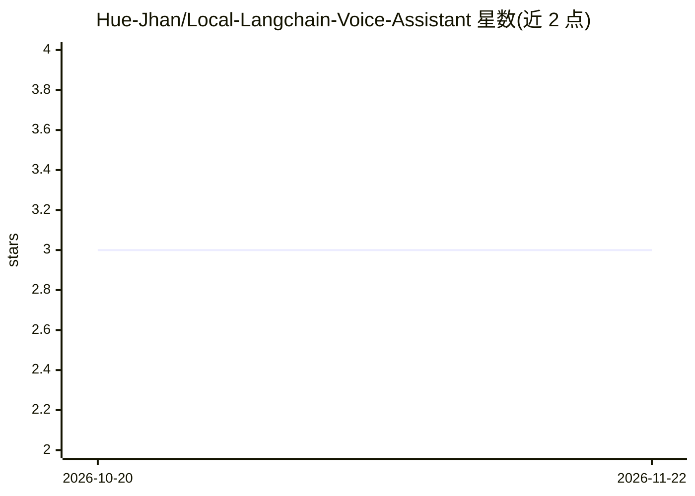

# Hue-Jhan/Local-Langchain-Voice-Assistant

⭐ 3 · Python · MIT · 推送 2026-10-09 · [GitHub](https://github.com/Hue-Jhan/Local-Langchain-Voice-Assistant) · 个人维护

**本地运行的语音助手：Ollama 模型听、说、联网搜索**

基于 LangChain 与 LangGraph 的本地语音助手：将本地 Ollama 模型接入网页搜索与时钟两个工具，回答经 Piper TTS 朗读，语音输入用离线 Vosk 识别（意大利语/英语）。SqliteSaver 检查点将各线程对话存入 SQLite，退出后会话保留；工具选择支持词表匹配（router，默认）与模型自主决策（model）两种模式。依赖本地运行的 ollama 服务及 PATH 上的 piper-tts 与 ffplay，语音与模型文件（约半 GB）需另行放置。作者说明约 90% 代码由模型生成。

## 筛选速览

| 维度 | 判定 | 备注 |
|---|---|---|
| AI 角色 | `ai-native` | 本体是模型或模型工具 |
| 许可风险 | `permissive` | MIT |
| 部署形态 | `library` | 以包/库形式分发 |
| 模型依赖 | local-ok | 支持本地模型 |
| 硬件要求 | — | 无带数字的原话,不猜 |
| 安装摩擦 | `low` | 无编译、无系统依赖或容器化 |
| 成熟度 | — | 结构信号不足 |

## 能力要点

- LangGraph agent 循环 + SqliteSaver 会话持久化
- 离线语音：Vosk 识别 + Piper TTS，支持意/英语
- 工具选择 router（词表匹配）与 model（模型决策）双模式
- 提供 CLI 与全屏终端界面及测试脚本

## 适用场景

- 在本地电脑上运行一个可听可说的离线语音助手
- 让语音助手代为执行网页搜索并朗读结果
- 在意/英语环境下用唤醒词交互

## 场景标签

`语音 Agent` · 领域:对话与助手

## 证据(README 行号)

> L3: Lightweight local LLM voice assistant that uses **LangChain** and **LangGraph** to connect a local Ollama model to a
> L20: The agent node sends the system prompt plus the recent messages to Ollama; `tools_condition` sends the answer to th
> L65: Needs `ollama` running, plus `piper-tts` and `ffplay` on your `PATH` for speech. `config.toml` sits in the top fold

## 星数曲线

2026-10-20 3 → 2026-11-22 3（+0）

---
*卡片 v1 · prompt 1.4 · 生成 2026-11-22 · 置信度 high · 依据 README sha `325779e6dc7d` · [字段定义](../../DATASET.md)*
