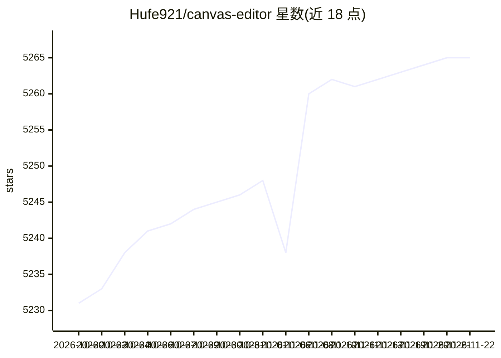

# Hufe921/canvas-editor

⭐ 5,265 · TypeScript · MIT · 推送 2026-11-21 · [GitHub](https://github.com/Hufe921/canvas-editor) · [官网](https://hufe.club/canvas-editor-docs) · 个人维护

**浏览器内 Canvas/SVG 渲染的所见即所得富文本编辑器**

基于 HTML canvas（可选 SVG 后端）渲染的文档编辑器，接管完整渲染管线以实现跨浏览器一致的排版、原生分页与打印保真，面向电子病历、法律合同、报告等 Word 类文档场景。功能覆盖富文本编辑、表格/图片/LaTeX 公式/日期选择器等元素插入、表单控件、页眉页脚水印、目录与批注、打印与 PDF 导出；通过增量布局与可见页渲染支持大文档，并以插件系统（instance.use）扩展 Word/Excel 导入导出等能力。npm 发布，Node.js 开发环境。

## 筛选速览

| 维度 | 判定 | 备注 |
|---|---|---|
| AI 角色 | `ai-enhanced` | 去掉 AI 部分产品仍成立 |
| 许可风险 | `permissive` | MIT |
| 部署形态 | `library` | 以包/库形式分发 |
| 模型依赖 | — | README 未给出锁定关系 |
| 硬件要求 | — | 无带数字的原话,不猜 |
| 安装摩擦 | `low` | 无编译、无系统依赖或容器化 |
| 成熟度 | — | 结构信号不足 |

## 能力要点

- Canvas 接管渲染管线，跨浏览器排版一致、原生分页
- 支持表格、图片、LaTeX 公式、日期选择器与表单控件插入
- 插件系统扩展 Word/Excel 导入导出、批注、拼写检查等
- 增量布局与 Web Workers 支持大文档与异步任务

## 适用场景

- 在网页中嵌入 Word 式文档编辑器做报告/合同排版
- 开发电子病历（EMR）等表单化文档系统
- 在浏览器中生成可打印/PDF 导出的文档

## 场景标签

 · 领域:前端组件/文档编辑器

## 证据(README 行号)

> L33: **Canvas Editor** is a feature-rich, WYSIWYG document editor rendered with HTML `<canvas>` (with an optional SVG ba
> L92: |feature/ai|AI-powered text processing demo|
> L161: This project is licensed under the MIT License.

## 星数曲线

2026-10-20 5,231 → 2026-11-22 5,265（+34）

---
*卡片 v1 · prompt 1.4 · 生成 2026-11-22 · 置信度 high · 依据 README sha `81d74b8776fc` · [字段定义](../../DATASET.md)*
