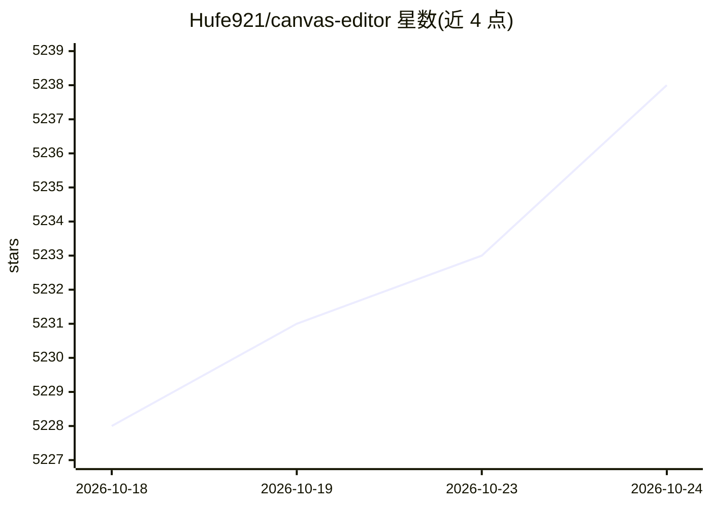

# Hufe921/canvas-editor

⭐ 5,238 · TypeScript · MIT · 推送 2026-10-24 · [GitHub](https://github.com/Hufe921/canvas-editor) · [官网](https://hufe.club/canvas-editor-docs) · 个人维护 · 中文 README

**基于 Canvas 的浏览器富文本/文档编辑器库，面向开发者**

基于 HTML Canvas API 构建的 WYSIWYG 文档编辑器 JavaScript 库，通过自控渲染管线实现跨浏览器一致的排版、原生分页（页眉页脚页码）、水印与打印导出。功能覆盖富文本、表格、图片、LaTeX 公式、表单控件、目录生成与评论等，提供插件系统扩展 Word/Excel 导入导出。适用于 EMR 电子病历、法律合同、报告等文档密集型 Web 应用。以 npm 包安装，开发需 Node.js 24+ 与 pnpm。

## 筛选速览

| 维度 | 判定 | 备注 |
|---|---|---|
| AI 角色 | `ai-enhanced` | 去掉 AI 部分产品仍成立 |
| 许可风险 | `permissive` | MIT |
| 部署形态 | `library` | 以包/库形式分发 |
| 模型依赖 | — | README 未给出锁定关系 |
| 硬件要求 | — | 无带数字的原话,不猜 |
| 安装摩擦 | `low` | 无编译、无系统依赖或容器化 |
| 成熟度 | — | 结构信号不足 |

## 能力要点

- Canvas 渲染管线，跨浏览器一致的像素级排版与原生分页
- 支持表格、图片、LaTeX 公式、表单控件、目录、评论等文档要素
- 插件系统，官方插件含 Word/Excel 导入导出、拼写检查等
- 打印/PDF 导出与页眉页脚、水印等页面布局配置

## 适用场景

- 在浏览器中构建类似 Word 的文档编辑体验
- 开发 EMR 电子病历、法律合同等文档密集型应用
- 需要跨浏览器排版一致性与精确分页的在线文档系统

## 场景标签

 · 领域:前端/文档编辑

## 证据(README 行号)

> L33: **Canvas Editor** is a feature-rich, WYSIWYG document editor built on top of the HTML `<canvas>` API. It is designe
> L91: |feature/ai|AI-powered text processing demo|

## 星数曲线

2026-10-18 5,228 → 2026-10-24 5,238（+10）

---
*卡片 v1 · prompt 1.4 · 生成 2026-10-20 · 置信度 high · 依据 README sha `fcb33860e81b` · [字段定义](../../DATASET.md)*
