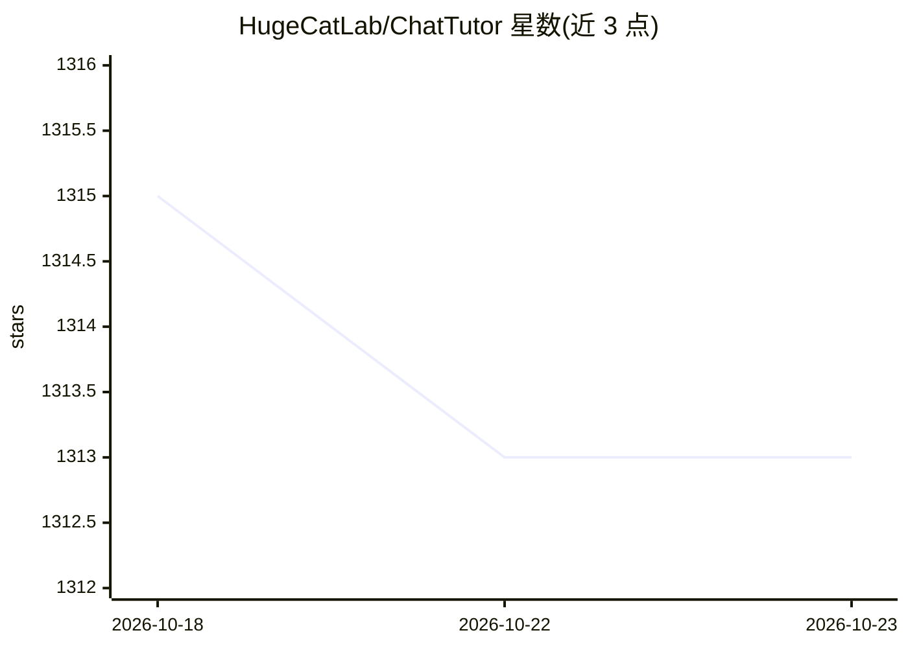

# HugeCatLab/ChatTutor

⭐ 1,313 · Vue · AGPL-3.0 · 推送 2026-01-09 · [GitHub](https://github.com/HugeCatLab/ChatTutor) · [官网](https://chattutor.app) · 组织维护 · 中文 README

**带电子白板的可视化交互 AI 教师，面向 STEM 学习者**

面向终端学习者的 AI 教学应用：将现实课堂中的教具搬到前端，提供数学画布与思维导图等可视化教学工具，让 AI 以动手方式讲解，弥补纯文本对话在 STEM 场景下表达力受限的问题。用户自带 API key，可配置 OpenAI、Anthropic、DeepSeek 等模型提供商及主对话模型与标题生成模型。支持 Docker Compose 一键部署，或以 Node.js/Bun/pnpm 从源码构建运行，后端依赖 PostgreSQL 数据库。

## 筛选速览

| 维度 | 判定 | 备注 |
|---|---|---|
| AI 角色 | `ai-native` | 本体是模型或模型工具 |
| 许可风险 | `viral` | AGPL-3.0 |
| 部署形态 | `self-host` | docker 或自建部署 |
| 模型依赖 | — | README 未给出锁定关系 |
| 硬件要求 | — | 无带数字的原话,不猜 |
| 安装摩擦 | `low` | 无编译、无系统依赖或容器化 |
| 成熟度 | — | 结构信号不足 |

## 能力要点

- 数学画布（Math Canvas）等白板式可视化教学工具
- 多模型提供商配置（OpenAI/Anthropic/DeepSeek，用户自带 API key）
- Docker Compose 部署与 pnpm 源码运行两种方式
- 基于 GeoGebra、Vue、Vite、ElysiaJS、AI SDK 构建

## 适用场景

- STEM 学科中通过图形化白板跟 AI 老师学习
- 在 chattutor.app 在线使用并配置自己的模型 key
- 自部署一套可视化 AI 辅导服务

## 场景标签

`AI 助手` · 领域:对话与助手

## 证据(README 行号)

> L21: ChatTutor is an AI teacher equipped with the ability to use an electronic whiteboard.
> L25: ChatTutor effectively solves this problem by bringing all the teaching tools used in real-world educational scenari
> L59: - `AGENT_MODEL`: Model for the main agent that chats with users (e.g., `gpt-4`)

## 星数曲线

2026-10-18 1,315 → 2026-10-23 1,313（-2）

---
*卡片 v1 · prompt 1.4 · 生成 2026-10-21 · 置信度 mid · 依据 README sha `66b28147de98` · [字段定义](../../DATASET.md)*
