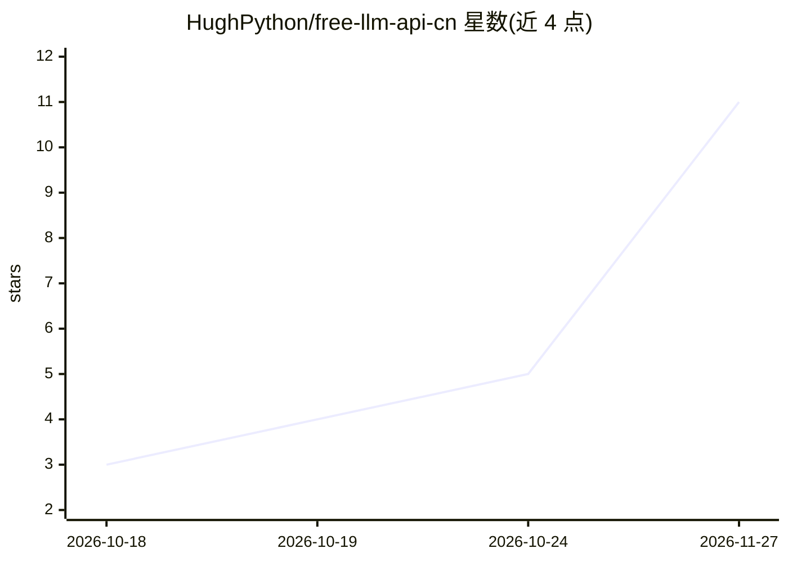

# HughPython/free-llm-api-cn

⭐ 11 · 推送 2026-10-06 · [GitHub](https://github.com/HughPython/free-llm-api-cn) · 个人维护 · 中文 README

**可直连的免费大模型 API 站点清单与接入指南**

汇总 10 个无需翻墙、无需绑卡、OpenAI 接口兼容的免费/低价大模型 API 站点，按速查表与站点详解组织，逐站给出注册网址、Base URL、登录/绑卡要求、免费额度机制（签到、积分、每日 Token）与实测备注；另列未收录站点及落选原因，并提供 OneAPI/NewAPI 中转、Cherry Studio 配置、RPM/RPD 限流等通用接入提示。

## 筛选速览

| 维度 | 判定 | 备注 |
|---|---|---|
| AI 角色 | `ai-knowledge` | 知识聚合/清单类 |
| 许可风险 | `none` | — |
| 部署形态 | `None` |  |
| 模型依赖 | — | README 未给出锁定关系 |
| 硬件要求 | — | 无带数字的原话,不猜 |
| 安装摩擦 | `low` | 无编译、无系统依赖或容器化 |
| 成熟度 | — | 结构信号不足 |

## 能力要点

- 10 个站点均兼容 OpenAI 接口格式，配置 Base URL + API Key + 模型名即可接入
- 逐站列出 Base URL、是否需翻墙/绑卡与免费额度机制
- 覆盖 DeepSeek、Qwen、GLM、Gemini、商汤等多家模型源
- 附通用接入提示：限流 429、模型名大小写、Base URL 斜杠等注意事项

## 适用场景

- 为 Cherry Studio、LobeChat 等客户端寻找免费模型接口
- 开发 Agent 或定时任务时选用免费额度的 API 站点
- 统一管理多家免费 Key 做中转接入

## 场景标签

`精选清单` · 领域:学习与行业

## 证据(README 行号)

> L1: # 免费大模型 API 指南
> L3: 长期实测可用的免费 / 低价大模型 API 汇总，**全部兼容 OpenAI 接口格式**，可直连 Cherry Studio、LobeChat、NextChat、OneAPI、各类 Agent 工具。
> L129: - 本清单所有站点均为 **OpenAI 兼容格式**，配置三项即可：`Base URL` + `API Key` + `模型名`。

## 星数曲线

2026-10-18 3 → 2026-11-27 11（+8）

---
*卡片 v1 · prompt 1.4 · 生成 2026-11-27 · 置信度 high · 依据 README sha `7876bd5b70f7` · [字段定义](../../DATASET.md)*
