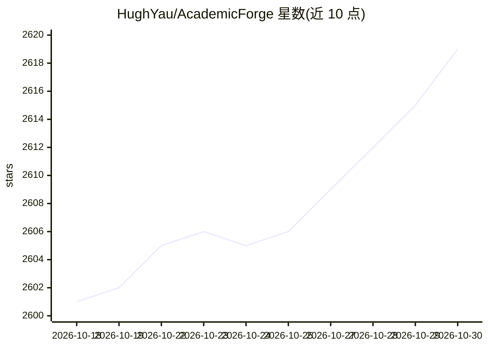

# HughYau/AcademicForge

⭐ 2,619 · Python · NOASSERTION · 推送 2026-08-30 · [GitHub](https://github.com/HughYau/AcademicForge) · [官网](http://hughyau.com/AcademicForge/) · 个人维护 · 中文 README

**面向 Claude Code/OpenCode/Codex 的学术技能选配与安装平台**

收集散落的学术 AI 技能（skill pack），通过选配站点浏览勾选后一键生成安装命令，在用户项目根目录执行 bash/PowerShell 脚本完成安装；已收录 Claude Science 内置的 32 个技能，覆盖结构预测、蛋白质设计、基因组与单细胞、图表可视化、文献写作、远程算力等六大主题，无需订阅 Claude Science 即可安装且跨 agent 通用。同名技能默认跳过，可加 --force 覆盖。仓库内容 MIT，第三方 skill 保留各自许可证。

## 筛选速览

| 维度 | 判定 | 备注 |
|---|---|---|
| AI 角色 | `ai-knowledge` | 知识聚合/清单类 |
| 许可风险 | `permissive` | NOASSERTION |
| 部署形态 | `None` |  |
| 模型依赖 | — | README 未给出锁定关系 |
| 硬件要求 | — | 无带数字的原话,不猜 |
| 安装摩擦 | `low` | 无编译、无系统依赖或容器化 |
| 成熟度 | — | 结构信号不足 |

## 能力要点

- 选配站勾选后一键生成针对 Claude Code / OpenCode / Codex 的安装命令
- 收录 Claude Science 的 32 个技能，分六大主题组织
- 提供 bash 与 PowerShell 两种安装脚本，支持 Windows
- 可将 agents.md 提示词交给 AI 智能体代为挑选技能

## 适用场景

- 为我的科研 agent 挑选并安装文献综述、图表绘制等学术技能
- 在不订阅 Claude Science 的情况下使用其 32 个科研技能
- 按需安装蛋白质设计、基因组分析等领域的 skill pack

## 场景标签

`提示工程` `科研工具` `精选清单` · 领域:Agent 开发

## 证据(README 行号)

> L5: **面向 Claude Code / OpenCode / Codex 的学术 Skill 选配与安装平台**
> L22: "Forge（锻造台）" 灵感来自 **Minecraft 的模组加载器系统**——就像 Minecraft Forge 整合包为特定游戏体验集成各种模组一样，**Academic Forge** 把散落各处的学术 AI 技能，锻
> L26: 1. 🖱️ 在站点里浏览、勾选需要的 pack
> L27: 2. 📋 一键生成安装命令

## 星数曲线

2026-10-18 2,601 → 2026-10-30 2,619（+18）

---
*卡片 v1 · prompt 1.4 · 生成 2026-10-21 · 置信度 high · 依据 README sha `92b06406befd` · [字段定义](../../DATASET.md)*
