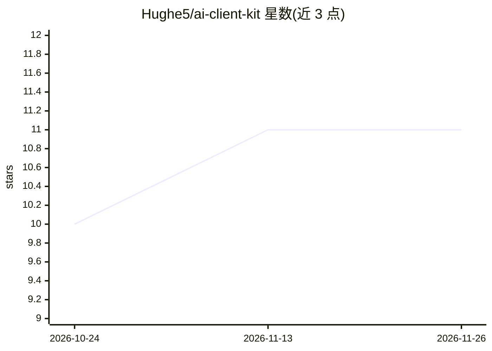

# Hughe5/ai-client-kit

⭐ 11 · TypeScript · Apache-2.0 · 推送 2025-12-06 · [GitHub](https://github.com/Hughe5/ai-client-kit) · 个人维护 · 中文 README

**前端开发者在任意 Web 应用中接入 AI 聊天的 SDK**

以 npm 包形式分发的前端 AI 集成套件：提供可挂载到 DOM 容器的聊天面板（AIChatPanel）、封装与大模型交互的 Agent class 供构建工作流，并支持配置系统消息与自定义工具函数（Function Calling）。纯原生实现，适配 React、Vue 等任意前端框架及纯 HTML 页面，另内置中文相对时间解析等工具函数。安装通过 npm/yarn，测试与构建均走 npm 脚本。

## 筛选速览

| 维度 | 判定 | 备注 |
|---|---|---|
| AI 角色 | `ai-ecosystem` | LLM/agent 周边工具 |
| 许可风险 | `permissive` | Apache-2.0 |
| 部署形态 | `library` | 以包/库形式分发 |
| 模型依赖 | — | README 未给出锁定关系 |
| 硬件要求 | — | 无带数字的原话,不猜 |
| 安装摩擦 | `low` | 无编译、无系统依赖或容器化 |
| 成熟度 | — | 结构信号不足 |

## 能力要点

- AIChatPanel 聊天面板挂载到指定 DOM 容器
- Agent class 封装与大模型交互的基础能力，可构建工作流
- 支持 Function Calling 自定义工具函数接入业务逻辑
- 纯原生实现，适配 React/Vue 等任意前端框架及纯 HTML

## 适用场景

- 在现有 Web 应用中快速挂载 AI 聊天面板
- 通过 Function Calling 把 AI 对话与业务逻辑结合
- 基于 Agent class 搭建自定义 AI 工作流

## 场景标签

`聊天机器人` `Agent 框架` · 领域:Agent 开发

## 证据(README 行号)

> L3: `AI Client Kit` 是一款 AI 集成套件，方便开发者在任意 Web 应用中接入 AI 功能。
> L12: - 纯原生实现，技术栈无关，适配任意前端框架（React、Vue 等）及纯 HTML 页面
> L13: - 封装了与大模型交互的基础工具类（Agent class），开发者可基于此构建灵活的工作流

## 星数曲线

2026-10-24 10 → 2026-11-26 11（+1）

---
*卡片 v1 · prompt 1.4 · 生成 2026-11-19 · 置信度 high · 依据 README sha `1396715cb2a6` · [字段定义](../../DATASET.md)*
