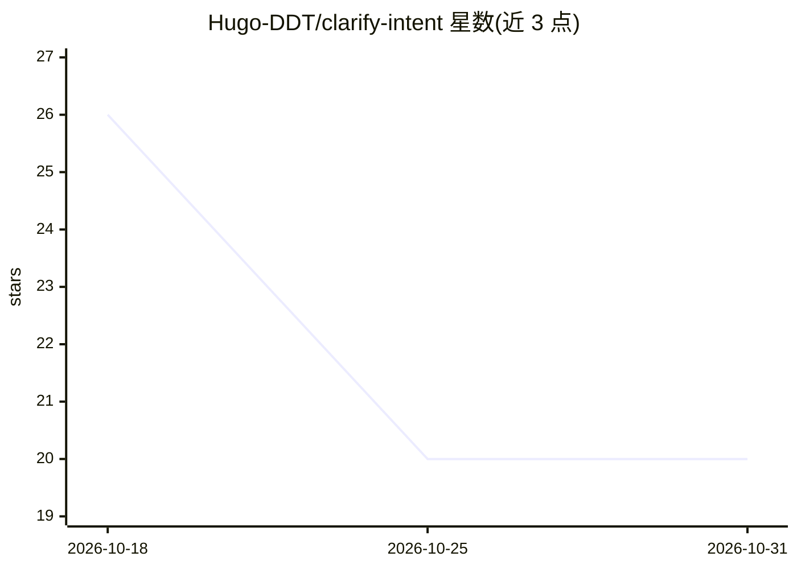

# Hugo-DDT/clarify-intent

⭐ 20 · MIT · 推送 2026-09-18 · [GitHub](https://github.com/Hugo-DDT/clarify-intent) · 个人维护 · 中文 README

**教 AI agent 何时提问、何时直接执行的意图对齐 Skill**

一个面向新手用户的 AI Skill（SKILL.md 形式），安装到 Claude Code、Cursor、Codex、Gemini CLI、GitHub Copilot 等 agent 工具的 skills 目录后生效。核心机制是四种行动模式：意图清楚则 PROCEED、低风险歧义可 ASSUME（声明假设后执行）、会改变结果的歧义只问一个最高价值问题（ASK）、不可逆或高影响动作需 CONFIRM。强调先读上下文再反问、允许合理默认、高风险动作单独确认，目标是减少返工而非需求访谈。附带分领域问题库（references/）与可测试的 EVALS.md。

## 筛选速览

| 维度 | 判定 | 备注 |
|---|---|---|
| AI 角色 | `ai-ecosystem` | LLM/agent 周边工具 |
| 许可风险 | `permissive` | MIT |
| 部署形态 | `library` | 以包/库形式分发 |
| 模型依赖 | — | README 未给出锁定关系 |
| 硬件要求 | — | 无带数字的原话,不猜 |
| 安装摩擦 | `low` | 无编译、无系统依赖或容器化 |
| 成熟度 | — | 结构信号不足 |

## 能力要点

- PROCEED/ASSUME/ASK/CONFIRM 四种行动模式的决策规则
- 默认一次一问，先问最能改变方向的问题
- 优先从文件、代码、配置读取上下文而非反问用户
- 跨多平台 skills 目录通用（.claude/skills/ 与 .agents/skills/）

## 适用场景

- 新手用户提需求笼统时，让 AI 先对齐关键意图再动手
- 避免 AI 把每个任务都变成冗长的问答流程
- 删除、覆盖、生产环境等高风险操作前获得单独确认

## 场景标签

`提示工程` · 领域:Agent 开发

## 证据(README 行号)

> L7: **Clarify Intent** 是一个面向新手用户的 AI Skill。它用于在真正会“方向跑偏”的地方提前对齐意图，同时避免把每个任务都变成需求访谈。
> L45: |模式|什么时候用|AI 怎么做|
> L77: |Claude Code|`.claude/skills/`|新建对话|

## 星数曲线

2026-10-18 26 → 2026-10-31 20（-6）

---
*卡片 v1 · prompt 1.4 · 生成 2026-10-28 · 置信度 high · 依据 README sha `2e5893d23e82` · [字段定义](../../DATASET.md)*
