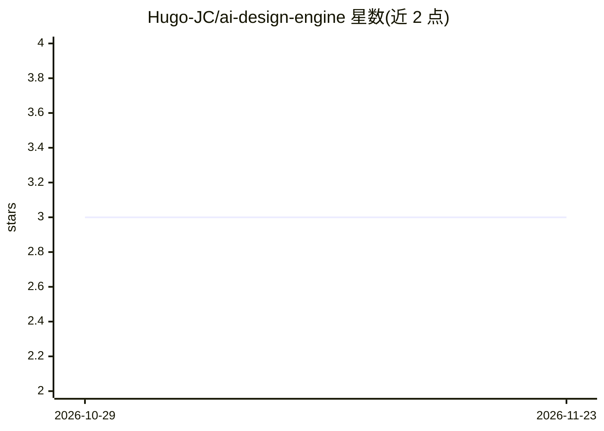

# Hugo-JC/ai-design-engine

⭐ 3 · JavaScript · 推送 2026-10-28 · [GitHub](https://github.com/Hugo-JC/ai-design-engine) · 个人维护

**给 AI agent 与设计师提供 UI 生成上下文与设计校验的工具**

AI Design Engine（alpha 阶段）通过确定性 prompt 路由识别需求所属的细分领域、品牌语调与风格，为生成界面的 AI agent 提供视觉 token、页面原型与可测校验规则（无障碍与对比度），目标是让 UI 生成从真实模式与品牌语言出发而非通用 prompt。内置 Node.js 命令行工具（route.js、bundle.js、validate-design.js），附带 agent 协议、样式 token 库与细分领域参考档案，面向设计师、生成界面的 agent、产品团队与创始人。

## 筛选速览

| 维度 | 判定 | 备注 |
|---|---|---|
| AI 角色 | `ai-ecosystem` | LLM/agent 周边工具 |
| 许可风险 | `none` | — |
| 部署形态 | `None` |  |
| 模型依赖 | — | README 未给出锁定关系 |
| 硬件要求 | — | 无带数字的原话,不猜 |
| 安装摩擦 | `low` | 无编译、无系统依赖或容器化 |
| 成熟度 | `idea` | |

## 能力要点

- 确定性 prompt 路由：按细分领域/语调/风格分发上下文
- 按领域与意图组织的视觉 token 与参考档案
- validate-design.js 对 HTML 做风格与无障碍/对比度校验
- 面向 agent 的协议与指令目录（agents/）

## 适用场景

- 为美妆电商、B2B SaaS 落地页等生成有品牌方向的原型
- 让 agent 在生成界面前获得上下文、token 与校验规则
- 交付前校验设计的可访问性与对比度

## 场景标签

`代码生成` `代码审查` `提示工程` · 领域:Agent 开发

## 证据(README 行号)

> L15: - contextos prontos para agentes de IA gerar interfaces melhores;
> L28: - agentes de IA que geram interfaces e precisam de contexto;
> L34: 1. O pedido entra no router.

## 星数曲线

2026-10-29 3 → 2026-11-23 3（+0）

---
*卡片 v1 · prompt 1.4 · 生成 2026-11-22 · 置信度 high · 依据 README sha `75611baa2782` · [字段定义](../../DATASET.md)*
