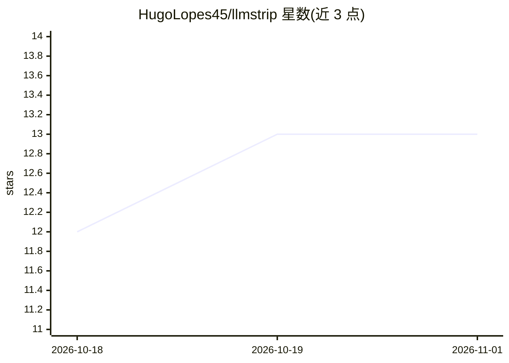

# HugoLopes45/llmstrip

⭐ 13 · Rust · MIT · 推送 2026-03-29 · [GitHub](https://github.com/HugoLopes45/llmstrip) · [官网](https://github.com/HugoLopes45/llmstrip) · 个人维护

**清除文本与代码中 AI 写作痕迹的提示词加 CLI 工具**

提供两种使用方式：一是系统提示词，可粘贴到任意 LLM 或作为 Claude Code 技能（/llmstrip 命令清理当前文件），由 LLM 按 34 条规则改写文本，覆盖正则无法处理的结构性模式；二是确定性二进制 llmstrip，在 CI 或 git hook 中运行 --report --fail 检测 AI 写作模式，无网络与运行时依赖。规则分词级（24 条，如禁用词 delve/robust）与结构级（10 条），依据 Kobak、Liang、Juzek 等同行评审语料研究。支持 Cursor、Copilot、Windsurf、Zed 的规则安装。

## 筛选速览

| 维度 | 判定 | 备注 |
|---|---|---|
| AI 角色 | `ai-native` | 本体是模型或模型工具 |
| 许可风险 | `permissive` | MIT |
| 部署形态 | `library` | 以包/库形式分发 |
| 模型依赖 | — | README 未给出锁定关系 |
| 硬件要求 | — | 无带数字的原话,不猜 |
| 安装摩擦 | `medium` | 含编译或系统依赖之一 |
| 成熟度 | — | 结构信号不足 |

## 能力要点

- 34 条规则（24 条词级 + 10 条结构级），依据同行评审语料研究
- 双形态：LLM 系统提示词改写 + 确定性 CLI 检测（无网络、无运行时）
- CI 门禁与 git hook 集成，可按严重度阈值 --fail
- 提供 Claude Code / Cursor / Copilot / Windsurf / Zed 安装目标

## 适用场景

- 通过 Claude Code hook 自动过滤每次 AI 回复中的套话
- 在 CI 或 commit-msg hook 中拦截 AI 生成的发布说明与提交信息
- 清理 AI 生成的代码注释与文风

## 场景标签

`提示工程` `AI 写作` · 领域:Agent 开发

## 证据(README 行号)

> L13: Paste the system prompt into any LLM, or use the Claude Code skill. The LLM rewrites your text using all 34 rules, 
> L17: Run `llmstrip --report --fail` in CI or as a git hook. Same rules, deterministic, no network, no runtime.
> L71: echo "Let me delve into this robust and comprehensive approach." | llmstrip

## 星数曲线

2026-10-18 12 → 2026-11-01 13（+1）

---
*卡片 v1 · prompt 1.4 · 生成 2026-10-31 · 置信度 high · 依据 README sha `1e56a684e94e` · [字段定义](../../DATASET.md)*
