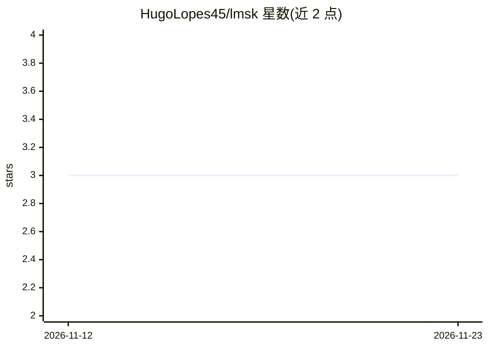

# HugoLopes45/lmsk

⭐ 3 · TypeScript · MIT · 推送 2026-11-16 · [GitHub](https://github.com/HugoLopes45/lmsk) · [官网](https://hugolopes45.github.io/lmsk/) · 个人维护

**给 AI 编码代理发送内容前遮蔽密钥/密码/邮箱的本地代理**

lmsk 以本地代理（Claude Code 前）或 pi 扩展形式运行，在请求发往模型前用 280 条内置检测规则（含 gitleaks 的 217 条厂商密钥规则）把 API 密钥、密码、token、邮箱等替换为假值，并用加密本地会话 vault 保存映射；用户读到的回复会还原真实值，受支持的文件与 shell 工具调用在执行前还原原值，同时阻止对 .env、SSH 密钥等受保护路径的访问。仅本地运行，无模型、无账号、无遥测；要求 macOS/Linux 与 Node.js 22.19+。

## 筛选速览

| 维度 | 判定 | 备注 |
|---|---|---|
| AI 角色 | `ai-ecosystem` | LLM/agent 周边工具 |
| 许可风险 | `permissive` | MIT |
| 部署形态 | `self-host` | docker 或自建部署 |
| 模型依赖 | — | README 未给出锁定关系 |
| 硬件要求 | — | 无带数字的原话,不猜 |
| 安装摩擦 | `low` | 无编译、无系统依赖或容器化 |
| 成熟度 | — | 结构信号不足 |

## 能力要点

- 280 条检测规则：厂商密钥、键值型密码、URL/头凭证、PII（邮箱/IBAN/卡号等）
- 本地加密会话 vault 保存假值↔原值映射，会话结束删除
- 受支持的文件与 shell 工具调用执行前还原原值，网络命令保持假值
- 导出 Guard 引擎供自有 agent 集成（maskPayload/restoreCall 等 API）

## 适用场景

- 让编码代理调试含真实密钥的日志而不泄漏密钥
- 代理编写含 API key 的配置文件时自动还原真实值
- 用自定义规则遮蔽客户名等项目敏感信息

## 场景标签

`网络安全` · 领域:学习与行业

## 证据(README 行号)

> L5: `lmsk` replaces detected API keys, passwords, tokens and emails with fakes before your AI coding agent sends a reque
> L49: 1. **Run locally.** lmsk works as a local proxy service in front of Claude Code, or as an extension inside pi.
> L111: **Which agents does it work with?**

## 星数曲线

2026-11-12 3 → 2026-11-23 3（+0）

---
*卡片 v1 · prompt 1.4 · 生成 2026-11-22 · 置信度 mid · 依据 README sha `681eacdbda44` · [字段定义](../../DATASET.md)*
