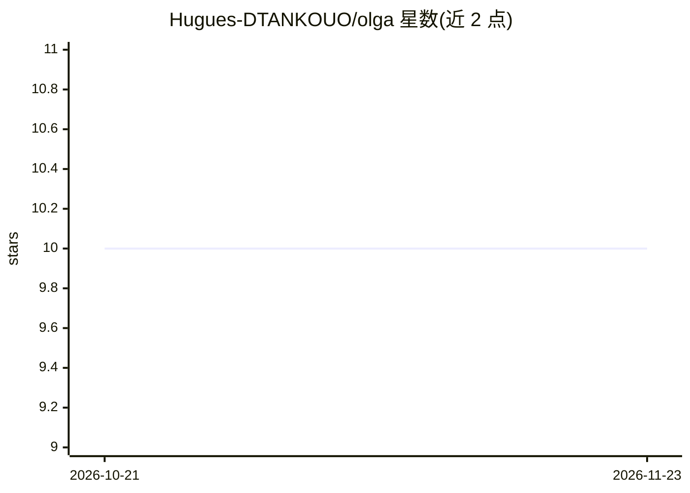

# Hugues-DTANKOUO/olga

⭐ 10 · Rust · Apache-2.0 · 推送 2026-05-26 · [GitHub](https://github.com/Hugues-DTANKOUO/olga) · [官网](https://hugues-dtankouo.github.io/olga/) · 个人维护

**为 LLM/RAG 流水线解析 PDF/DOCX/XLSX/HTML 为 Markdown 与类型化 JSON**

用 Rust 实现的文档解析引擎，提供严格类型化的 Python 绑定与 CLI：读取 PDF、DOCX、XLSX、HTML 的原生内容流，输出 Markdown、纯文本或含 16 种元素变体的 TypedDict JSON 树，保留页面布局、边界框与来源信息。流程中不使用 LLM，也不要求 GPU。提供 processability() 预检机制，在流水线开始前标记扫描件或损坏文件；不适合纯扫描 PDF 与渲染后语义的 HTML。以 pip 包（olgadoc）与 Rust crate（olga）分发，Apache 2.0 许可。

## 筛选速览

| 维度 | 判定 | 备注 |
|---|---|---|
| AI 角色 | `ai-ecosystem` | LLM/agent 周边工具 |
| 许可风险 | `permissive` | Apache-2.0 |
| 部署形态 | `library` | 以包/库形式分发 |
| 模型依赖 | — | README 未给出锁定关系 |
| 硬件要求 | `cpu-ok` | |
| 安装摩擦 | `low` | 无编译、无系统依赖或容器化 |
| 成熟度 | `idea` | |

## 能力要点

- 单一 Document API 覆盖 PDF/DOCX/XLSX/HTML 四种格式
- 输出保留空间保真的 Markdown 与严格类型化 JSON（mypy --strict 兼容）
- OCR 预检 processability() 在下游前标记扫描/损坏文件
- 提供 CLI：提取、元数据检查、全文搜索、按页提取

## 适用场景

- 为 RAG 检索生成带页码与 bbox 出处信息的文档分块
- 从报销单、发票、合同中提取表格与结构化数据
- 在调用 OCR 或 LLM 前批量健康检查文档目录
- 将遗留 PDF/DOCX 档案迁移为 JSON/Markdown 以便重建索引

## 场景标签

`文档解析` · 领域:知识与检索

## 证据(README 行号)

> L6: > Rust core, strictly-typed Python bindings. No LLM in the loop.
> L23: meaning; lose it and every downstream stage — RAG, LLM extraction,
> L104: - **Retrieval-augmented generation.** Chunk documents with provenance

## 星数曲线

2026-10-21 10 → 2026-11-23 10（+0）

---
*卡片 v1 · prompt 1.4 · 生成 2026-11-20 · 置信度 high · 依据 README sha `3420daa9122f` · [字段定义](../../DATASET.md)*
