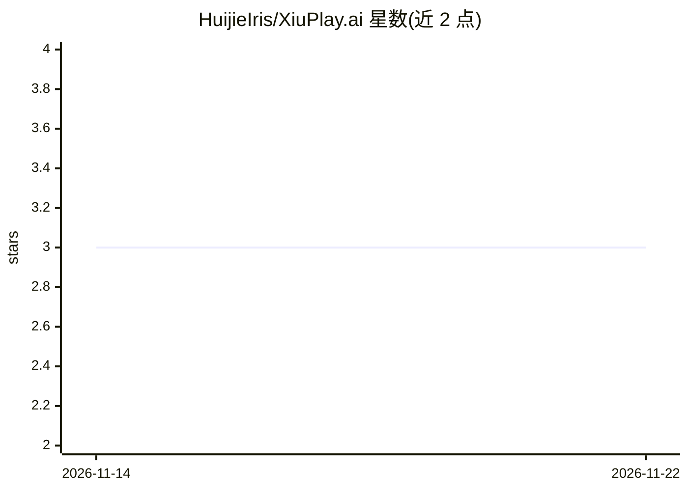

# HuijieIris/XiuPlay.ai

⭐ 3 · TypeScript · 推送 2026-11-10 · [GitHub](https://github.com/HuijieIris/XiuPlay.ai) · 个人维护 · 中文 README

**本地优先桌面 agent：把一个游戏点子变成可玩的 Web/Godot 游戏**

基于 Electron 的 macOS 桌面应用，接入 Codex App Server 与 Godot 4，以受限生产流水线运行：只读 Planner 定范围、Implementer 在隔离项目目录内实现、独立 Reviewer 审查，宿主端完成构建与自动试玩（沙箱浏览器采集运行证据），未通过检查触发最多三轮修复。媒体资产走可配置的图像/音频/3D REST 通道或 Codex ImageGen。每个生成游戏是普通本地项目，可脱离本工具继续开发。当前仅 macOS 目标，预览包未签名公证，仓库尚未发布许可证。

## 筛选速览

| 维度 | 判定 | 备注 |
|---|---|---|
| AI 角色 | `ai-native` | 本体是模型或模型工具 |
| 许可风险 | `none` | — |
| 部署形态 | `None` |  |
| 模型依赖 | — | README 未给出锁定关系 |
| 硬件要求 | — | 无带数字的原话,不猜 |
| 安装摩擦 | `low` | 无编译、无系统依赖或容器化 |
| 成熟度 | `idea` | |

## 能力要点

- Planner→Implementer→Reviewer→构建→自动试玩的审查门控流水线，失败触发最多三轮修复
- ChatGPT 登录与阿里百炼 Key 两条运行路线，各自独立 Codex 目录互不混合
- 生成结果为独立本地 Web 或 Godot 4 项目，支持 Git 提交与导出
- API key 经 Electron safeStorage 密封，预览服务器仅绑定 127.0.0.1

## 适用场景

- 用一句自然语言描述生成可试玩的 Web 或 Godot 游戏
- 需要审查门控和自动试玩验证的 agent 游戏生产流程
- 在本地拥有并继续改造 agent 生成的游戏项目

## 场景标签

`编码 Agent` `多智能体` `浏览器自动化` `代码生成` · 领域:Agent 开发

## 证据(README 行号)

> L5:  Turn one game idea into a reviewed, playable Web or Godot game.
> L6:  A local-first desktop production agent powered by Codex App Server and Godot 4.
> L21: XiuPlay.ai gives Codex a bounded game-production loop instead of asking one agent to improvise everything in a sing

## 星数曲线

2026-11-14 3 → 2026-11-22 3（+0）

---
*卡片 v1 · prompt 1.4 · 生成 2026-11-22 · 置信度 high · 依据 README sha `86bfeaef6616` · [字段定义](../../DATASET.md)*
