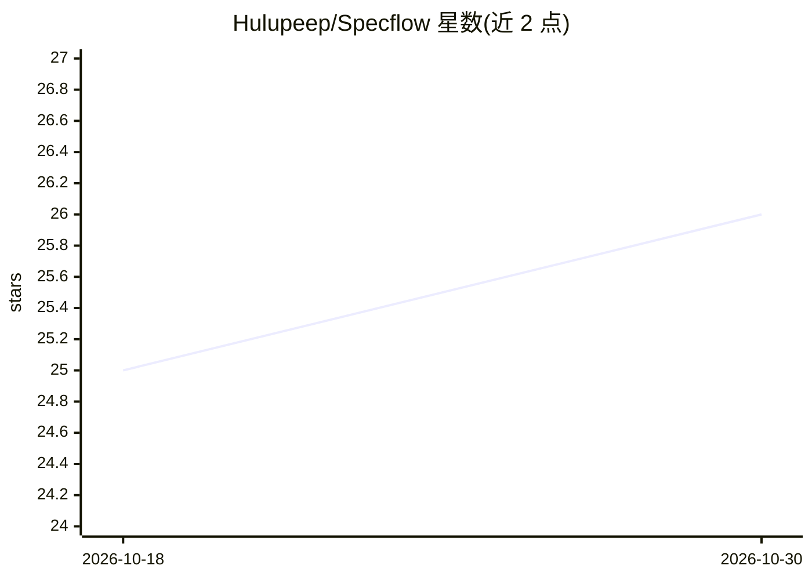

# Hulupeep/Specflow

⭐ 26 · JavaScript · MIT · 推送 2026-10-29 · [GitHub](https://github.com/Hulupeep/Specflow) · 个人维护

**把项目规格转成契约测试，拦截 LLM 编码漂移**

面向使用 Claude Code / Codex 等 coding agent 的开发者，把书面规格变成可机械执行的契约：YAML 规则扫描源码中的禁止模式（如 service worker 使用 localStorage），违规即构建失败；Playwright journey 测试守护关键用户流程；hooks 在构建/提交时自动触发并在无 issue 号时拒绝提交。另提供 spec-build / feature-build 两阶段工作流、30+ agent 编排、run contract 与 ledger 持久化证据，以及 Duo 模式（一个 agent 构建、另一个独立评审）。通过 npx 安装，Windows 需在 Git Bash 下运行。

## 筛选速览

| 维度 | 判定 | 备注 |
|---|---|---|
| AI 角色 | `ai-ecosystem` | LLM/agent 周边工具 |
| 许可风险 | `permissive` | MIT |
| 部署形态 | `library` | 以包/库形式分发 |
| 模型依赖 | locked-api |  |
| 硬件要求 | — | 无带数字的原话,不猜 |
| 安装摩擦 | `low` | 无编译、无系统依赖或容器化 |
| 成熟度 | — | 结构信号不足 |

## 能力要点

- YAML 契约测试扫描源码禁止模式，违规即构建失败
- Playwright journey 测试守护关键用户流程
- Duo 模式：Claude Code 与 Codex 互相独立评审
- run contract + ledger 持久化运行证据，人工门控不可跳过

## 适用场景

- 我需要防止 LLM agent 在多轮迭代后悄悄违反项目规格
- 给 CI 加一道 PR 合规门，禁止契约违规合入 main
- 让两个 coding agent 互相评审同一目标与验收标准

## 场景标签

`编码 Agent` `代码审查` · 领域:编码与开发

## 证据(README 行号)

> L5: LLMs drift. You write a rule; three iterations later the model "helpfully" ignores it. Specflow turns your specs int
> L19: Contract tests scan your source code for forbidden patterns. Break a rule → build fails. Journey tests run Playwrig
> L146: As models get stronger they need less prompt scaffolding — so prompts, skills, and sprint decomposition are expect

## 星数曲线

2026-10-18 25 → 2026-10-30 26（+1）

---
*卡片 v1 · prompt 1.4 · 生成 2026-10-27 · 置信度 high · 依据 README sha `8f76b1be0e23` · [字段定义](../../DATASET.md)*
