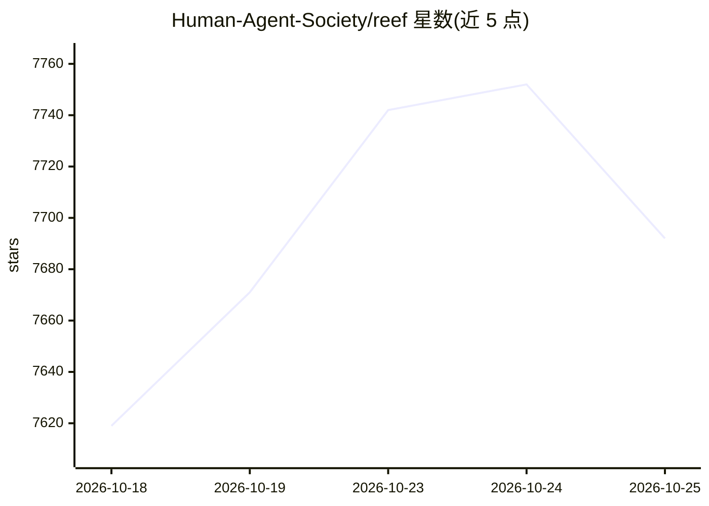

# Human-Agent-Society/reef

⭐ 7,719 · Python · Apache-2.0 · 推送 2026-10-25 · [GitHub](https://github.com/Human-Agent-Society/reef) · [官网](https://reefinfra.ai) · 组织维护 · 中文 README

**持续自我改进 agent 的基础设施：连接推理、反馈、训练与版本化交付**

面向希望 agent 从交互反馈中持续变强的开发者，Reef 提供一条连接推理服务、反馈记录、训练与版本化发布的基础设施：以 OpenAI/Anthropic 兼容的 HTTP 端点接收请求并返回 receipt，反馈关联到记录后由 recipe 产出更新，经评估提交到版本历史，更新期间服务不中断。学习面分两类：用 Slime 与 SGLang 训练模型权重（需 GPU 栈），或仅靠模型端点优化 harness（提示、规则、技能）。以 Python 包 reef-infra 发布，附多类 recipe 与基准结果。

## 筛选速览

| 维度 | 判定 | 备注 |
|---|---|---|
| AI 角色 | `ai-ecosystem` | LLM/agent 周边工具 |
| 许可风险 | `permissive` | Apache-2.0 |
| 部署形态 | `library` | 以包/库形式分发 |
| 模型依赖 | — | README 未给出锁定关系 |
| 硬件要求 | — | 无带数字的原话,不猜 |
| 安装摩擦 | `low` | 无编译、无系统依赖或容器化 |
| 成熟度 | — | 结构信号不足 |

## 能力要点

- OpenAI/Anthropic 兼容推理端点，反馈经 receipt 关联到交互记录
- Serve→Observe→Grow→Commit 四步学习循环，带版本历史与在线更新
- 支持模型权重训练（Slime/SGLang）与 harness 演化（Reefine）两条学习路径
- 按任务类型提供 recipe 目录，附各基准的测量结果与局限说明

## 适用场景

- 让线上 agent 从用户使用与打分反馈中持续改进
- 在 GPU 栈上用 RL 训练自有模型权重并在线热更新
- 不训练权重，仅靠模型 API 让编码 harness 的提示与技能自我演化
- 科学发现场景下做 test-time training 实验

## 场景标签

`强化学习` · 领域:训练与推理

## 证据(README 行号)

> L14: Reef is the first open-source infrastructure for continual self-improving agents.
> L15: It connects agent inference, feedback, learning, and versioned delivery. Use it
> L54: |**1&nbsp;·&nbsp;Serve**|Serve agent requests and record interactions.|`service/` — agent requests and interaction 

## 星数曲线

2026-10-18 7,619 → 2026-10-25 7,692（+73）

---
*卡片 v1 · prompt 1.4 · 生成 2026-10-20 · 置信度 high · 依据 README sha `c674833bda76` · [字段定义](../../DATASET.md)*
