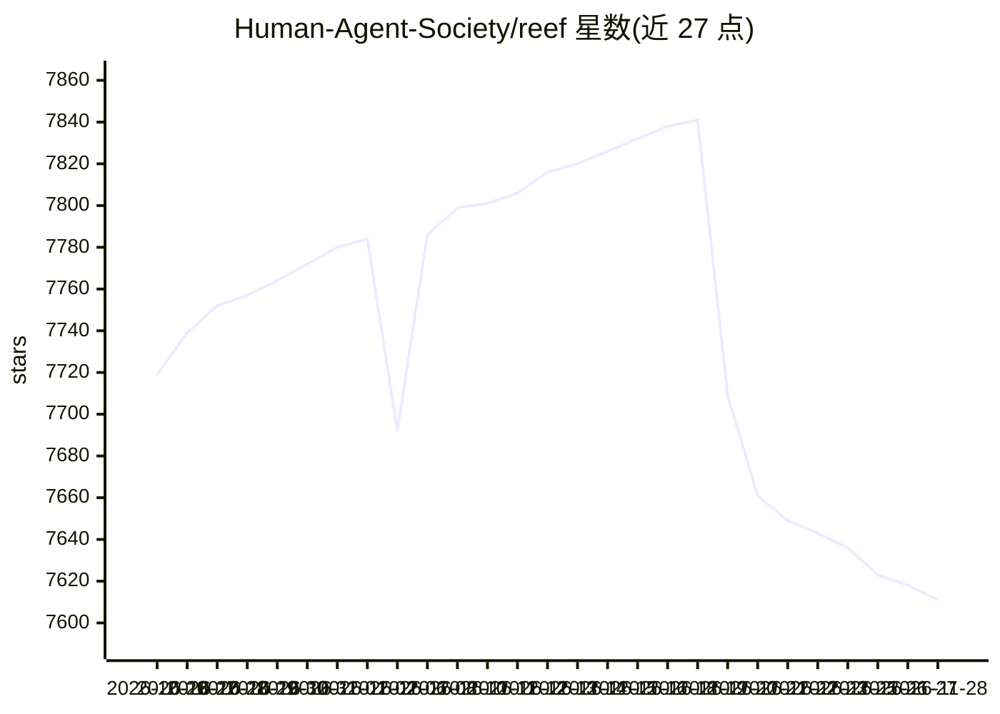

# Human-Agent-Society/reef

⭐ 7,611 · Python · Apache-2.0 · 推送 2026-11-27 · [GitHub](https://github.com/Human-Agent-Society/reef) · [官网](https://reefinfra.ai) · 组织维护 · 中文 README

**自改进 Agent 的持续学习基础设施：推理、反馈、训练与版本发布**

Reef 将 agent 的推理服务、反馈记录、训练更新与版本化交付串联为持续学习循环，分四步执行：Serve（服务请求并记录交互）、Observe（匹配反馈）、Grow（由 recipe 产出更新）、Commit（评估并发布到版本历史）。支持两条学习路径：用 Slime/SGLang 等训练模型权重，或无需本地 GPU、仅用模型 API 进化 agent harness（提示词、规则、技能）。推理端点兼容 OpenAI/Anthropic 请求格式，通过 PyPI 包或源码安装。

## 筛选速览

| 维度 | 判定 | 备注 |
|---|---|---|
| AI 角色 | `ai-ecosystem` | LLM/agent 周边工具 |
| 许可风险 | `permissive` | Apache-2.0 |
| 部署形态 | `library` | 以包/库形式分发 |
| 模型依赖 | local-ok | 支持本地模型 |
| 硬件要求 | — | 无带数字的原话,不猜 |
| 安装摩擦 | `low` | 无编译、无系统依赖或容器化 |
| 成熟度 | — | 结构信号不足 |

## 能力要点

- Serve→Observe→Grow→Commit 四步学习循环与版本化快照发布
- 推理端点兼容 OpenAI/Anthropic 请求体（/v1/chat/completions、/v1/messages）
- harness 进化路径只需模型端点，无需本地训练 GPU
- 按任务类型组织的 recipe 目录（SFT、GEPA、SAO、SDFT 等）

## 适用场景

- 让模型权重随用户交互反馈持续训练更新
- 从打分反馈中自动进化 coding agent 的技能与规则
- 构建不重启服务即可热加载新 checkpoint 的推理部署

## 场景标签

`强化学习` `微调` · 领域:训练与推理

## 证据(README 行号)

> L14: Reef is the first open-source infrastructure for continual self-improving agents.
> L15: It connects agent inference, feedback, learning, and versioned delivery. Use it
> L55:  Reef serves requests, records feedback, produces updates, and commits accepted updates to a version history.

## 星数曲线

2026-10-26 7,719 → 2026-11-28 7,611（-108）

---
*卡片 v1 · prompt 1.4 · 生成 2026-11-23 · 置信度 high · 依据 README sha `78be2a4ba8a6` · [字段定义](../../DATASET.md)*
