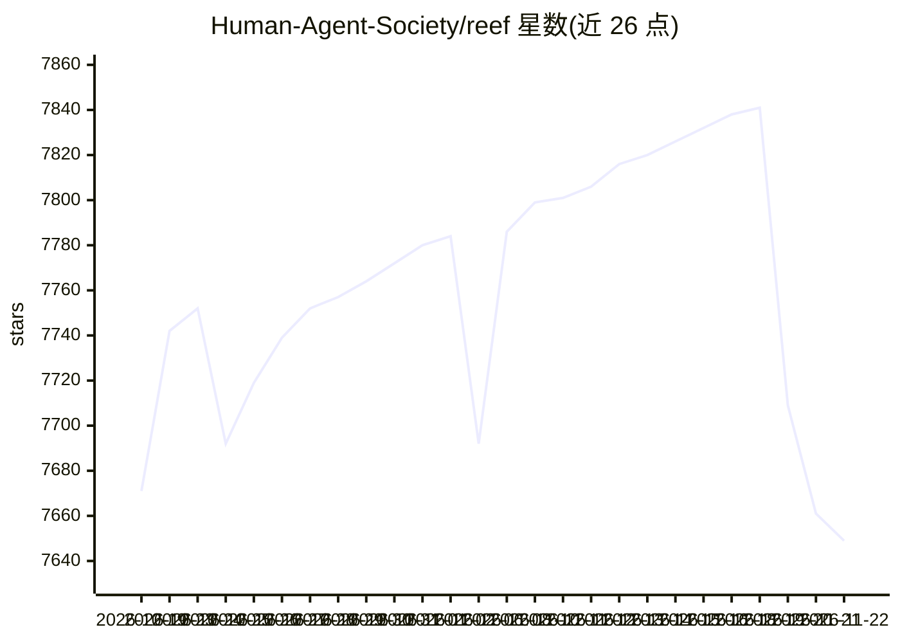

# Human-Agent-Society/reef

⭐ 7,649 · Python · Apache-2.0 · 推送 2026-11-21 · [GitHub](https://github.com/Human-Agent-Society/reef) · [官网](https://reefinfra.ai) · 组织维护 · 中文 README

**给开发者的持续自我改进 agent 基础设施：连接推理、反馈、训练与版本发布**

Reef 是用于持续自我改进 agent 的基础设施，将 agent 推理、反馈记录、学习更新与带版本的产物发布连接起来。工作流程分四步：Serve（服务请求并记录交互）、Observe（匹配反馈到交互记录）、Grow（由记录产生更新）、Commit（评估候选并发布版本快照）。支持两条学习路径：用 Slime/SGLang 等训练模型权重，或仅用模型 API 演进 agent harness（提示词、规则、技能）。推理端点兼容 OpenAI/Anthropic 请求格式。权重训练需要 GPU 环境，harness 演进只需模型端点。通过 PyPI 或源码安装，产物与检查点依赖 git-lfs。

## 筛选速览

| 维度 | 判定 | 备注 |
|---|---|---|
| AI 角色 | `ai-ecosystem` | LLM/agent 周边工具 |
| 许可风险 | `permissive` | Apache-2.0 |
| 部署形态 | `library` | 以包/库形式分发 |
| 模型依赖 | — | README 未给出锁定关系 |
| 硬件要求 | — | 无带数字的原话,不猜 |
| 安装摩擦 | `low` | 无编译、无系统依赖或容器化 |
| 成熟度 | `idea` | |

## 能力要点

- Serve→Observe→Grow→Commit 四步学习闭环，评估通过的更新以版本快照发布
- 推理端点兼容 OpenAI/Anthropic 格式（/v1/chat/completions、/v1/responses、/v1/messages）
- 支持权重训练（Slime、SGLang、Tinker 等组件）与 harness 演进两条路径
- 内置多种 recipe（SAO、GEPA、SDFT、SDPO、OPD、Meta-Harness 等）按任务类型选择

## 适用场景

- 让 agent 通过用户交互反馈持续学习并更新模型权重
- 无本地 GPU 时仅用模型 API 演进 agent 的提示词、规则与技能
- 面向有可度量目标的开放探索任务做 test-time training
- 在推理服务不中断的情况下滚动发布训练后的新版本

## 场景标签

`强化学习` `微调` · 领域:训练与推理

## 证据(README 行号)

> L14: Reef is the first open-source infrastructure for continual self-improving agents.
> L16: to train model weights with Slime and SGLang, or improve an agent's harness, including its prompts, rules, and skil
> L45: |Ability|Inference engine (vLLM, SGLang, …)|RL training framework (Slime, veRL, AReaL, …)|**Reef**|

## 星数曲线

2026-10-19 7,671 → 2026-11-22 7,649（-22）

---
*卡片 v1 · prompt 1.4 · 生成 2026-11-22 · 置信度 high · 依据 README sha `74e04794f864` · [字段定义](../../DATASET.md)*
