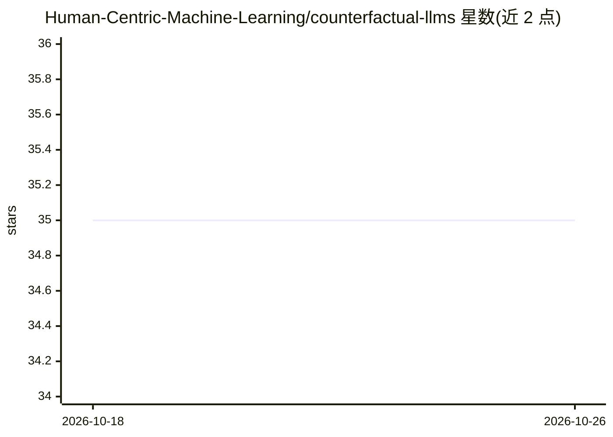

# Human-Centric-Machine-Learning/counterfactual-llms

⭐ 35 · Jupyter Notebook · 推送 2026-10-07 · [GitHub](https://github.com/Human-Centric-Machine-Learning/counterfactual-llms) · 组织维护

**论文代码：让 LLM 对已生成 token 做反事实生成**

"Counterfactual Token Generation in Large Language Models"（CLeaR 2025）的官方代码。基于 Gumbel-Max 结构因果模型构建 token 生成因果模型，使 LLM 能以接近常规生成的开销对过去的 token 选择做反事实推演，无需微调或提示工程。实现于 Llama 3 8B-Instruct 与 Ministral-8B-Instruct，需自行获取权重放入占位目录，含复现论文图表的脚本与 notebook，以及反事实生成用于偏见检测的实验。

## 筛选速览

| 维度 | 判定 | 备注 |
|---|---|---|
| AI 角色 | `ai-native` | 本体是模型或模型工具 |
| 许可风险 | `none` | — |
| 部署形态 | `library` | 以包/库形式分发 |
| 模型依赖 | — | README 未给出锁定关系 |
| 硬件要求 | — | 无带数字的原话,不猜 |
| 安装摩擦 | `low` | 无编译、无系统依赖或容器化 |
| 成熟度 | — | 结构信号不足 |

## 能力要点

- 基于 Gumbel-Max 结构因果模型的反事实 token 生成，接近常规生成开销
- 无需微调与提示工程，支持 top-p/top-k 变体采样
- 在 Llama 3 8B-Instruct 与 Ministral-8B-Instruct 上实现
- 含论文全部实验脚本与图表复现 notebook

## 适用场景

- 复现论文的反事实生成与偏见检测实验
- 研究 LLM 生成内容的反事实替代版本
- 对单个查询执行事实/反事实 token 生成对比

## 场景标签

`科研工具` · 领域:学习与行业

## 证据(README 行号)

> L10: *"Sure, I am happy to generate a story for you: Captain Lyra stood at the helm of her trusty ship, the Maelstrom’s 
> L22: Our code builds upon the popular open-weight large language models Llama 3 8B-instruct and Ministral-8B-instruct. F

## 星数曲线

2026-10-18 35 → 2026-10-26 35（+0）

---
*卡片 v1 · prompt 1.4 · 生成 2026-10-25 · 置信度 high · 依据 README sha `3e26b397833d` · [字段定义](../../DATASET.md)*
