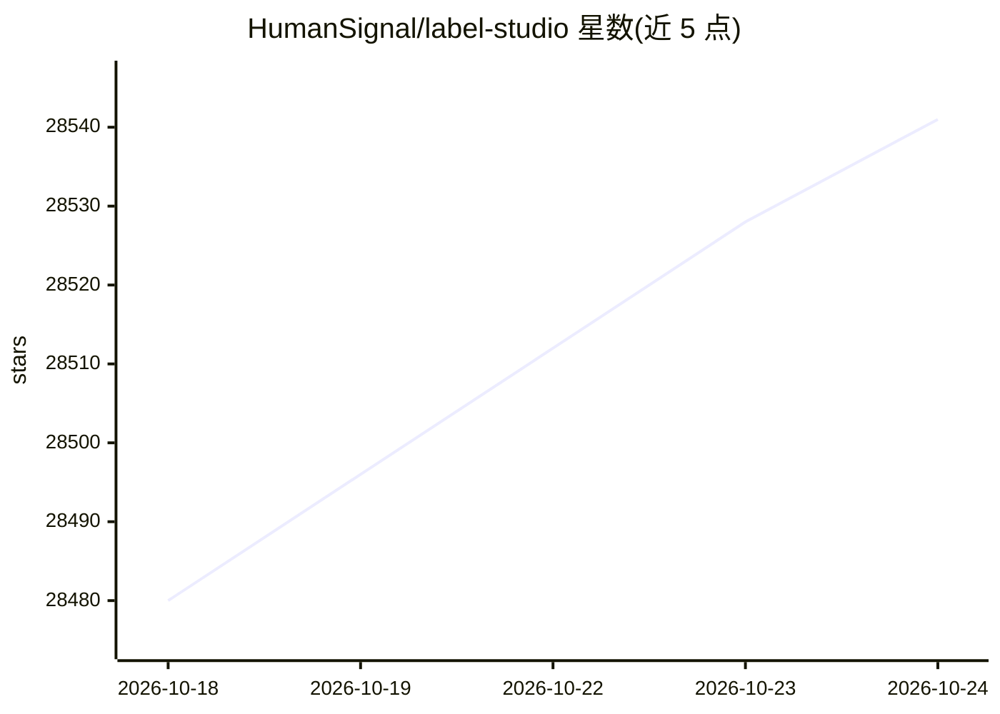

# HumanSignal/label-studio

⭐ 28,541 · TypeScript · Apache-2.0 · 推送 2026-10-23 · [GitHub](https://github.com/HumanSignal/label-studio) · [官网](https://labelstud.io) · 组织维护

**面向 ML 团队的多类型数据标注与标注工具**

开源数据标注工具，支持对音频、文本、图像、视频、时间序列等数据类型进行标注，提供直观 UI 并可导出多种模型训练格式，用于准备原始数据或改进已有训练数据。关键机制包括：多用户账号与多项目管理、可配置的标注界面模板与专用配置语言、从 AWS S3/Google Cloud Storage 或文件导入、通过 ML SDK 连接模型后端实现预标注、在线学习与主动学习、REST API 嵌入数据流水线。限制方面：README 未提及移动端；Windows 需额外安装 wheel 依赖；Python 要求 >=3.10。

## 筛选速览

| 维度 | 判定 | 备注 |
|---|---|---|
| AI 角色 | `ai-ecosystem` | LLM/agent 周边工具 |
| 许可风险 | `permissive` | Apache-2.0 |
| 部署形态 | `self-host` | docker 或自建部署 |
| 模型依赖 | — | README 未给出锁定关系 |
| 硬件要求 | — | 无带数字的原话,不猜 |
| 安装摩擦 | `low` | 无编译、无系统依赖或容器化 |
| 成熟度 | — | 结构信号不足 |

## 动量与使用信号

- 维护:`active` — 距上次 push 1.5 天,年发版 5,150 位贡献者
- 涨星:近 1 天 **+7**(自 20261016 起算)
- 安装:pypi 包 `label-studio` 月下载 27,780
- 平台:LINUX · 协议:—

## 能力要点

- 支持图像、音频、文本、HTML、时间序列、视频等多类型数据标注
- 通过 ML SDK 连接模型后端，支持预标注、在线学习与主动学习
- 提供 Docker、pip、poetry、Anaconda 等多种安装与部署方式
- REST API 支持嵌入现有数据流水线，前端/后端可独立集成

## 适用场景

- 为计算机视觉项目标注图像与边界框数据集
- 为 NLP 模型准备文本标注训练数据
- 多人协作标注团队的项目与账号管理
- 结合模型后端做主动学习式标注迭代

## 场景标签

`MLOps` · 领域:训练与推理

## 证据(README 行号)

> L7: Label Studio is an open source data labeling tool. It lets you label data types like audio, text, images, videos, an
> L158: - **Integration with machine learning models** so that you can visualize and compare predictions from different mo
> L167: Connect your favorite machine learning model using the Label Studio Machine Learning SDK. Follow these steps:

## 星数曲线

2026-10-18 28,480 → 2026-10-24 28,541（+61）

---
*卡片 v1 · prompt 1.4 · 生成 2026-10-18 · 置信度 high · 依据 README sha `96e4f93f87ef` · [字段定义](../../DATASET.md)*
