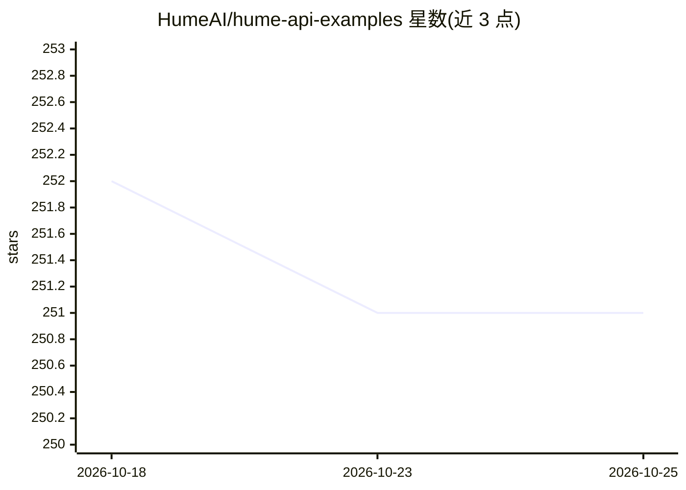

# HumeAI/hume-api-examples

⭐ 251 · TypeScript · MIT · 推送 2026-10-24 · [GitHub](https://github.com/HumeAI/hume-api-examples) · 组织维护

**Hume AI 官方示例集：指导接入 TTS 与共情语音接口**

HumeAI 官方维护的示例项目仓库，收录集成 Hume API 的快速入门与示例工程，覆盖两大能力：情感化文本转语音（TTS）与共情语音接口 EVI（会话式语音代理）。示例以多种语言与框架提供，包括 Python、TypeScript/Next.js、C#/.NET、Swift/iOS、Flutter、React Native、Unity、Vue 等，并演示 function calling、webhooks、通话代理服务器等接入模式。使用需从 Hume 平台获取 API key 认证；每个示例附带含安装依赖与运行步骤的 README。全部项目采用 MIT 许可。

## 筛选速览

| 维度 | 判定 | 备注 |
|---|---|---|
| AI 角色 | `ai-ecosystem` | LLM/agent 周边工具 |
| 许可风险 | `permissive` | MIT |
| 部署形态 | `None` |  |
| 模型依赖 | — | README 未给出锁定关系 |
| 硬件要求 | — | 无带数字的原话,不猜 |
| 安装摩擦 | `medium` | 含编译或系统依赖之一 |
| 成熟度 | — | 结构信号不足 |

## 能力要点

- TTS 示例 10 个，覆盖 .NET/Next.js/LiveKit/Swift/Unity 等
- EVI 示例约 26 个，含 function calling、webhooks、通话代理服务器
- API key 认证与各示例分步运行说明
- 全部项目 MIT 许可

## 适用场景

- 为应用接入 Hume 情感化 TTS 找参考实现
- 基于 EVI 构建会话式语音代理时查找对应语言/框架示例
- 了解 EVI 的 function calling 与 webhooks 接入方式

## 场景标签

`语音合成` `语音 Agent` · 领域:对话与助手

## 证据(README 行号)

> L3:  Browse sample code and projects designed to help you integrate Hume APIs
> L11: Welcome to the official Hume API Examples repository!
> L12: Here you'll find open-source example projects and quickstart guides to help you integrate the Hume API across a var

## 星数曲线

2026-10-18 252 → 2026-10-25 251（-1）

---
*卡片 v1 · prompt 1.4 · 生成 2026-10-22 · 置信度 high · 依据 README sha `a81b7259d22f` · [字段定义](../../DATASET.md)*
