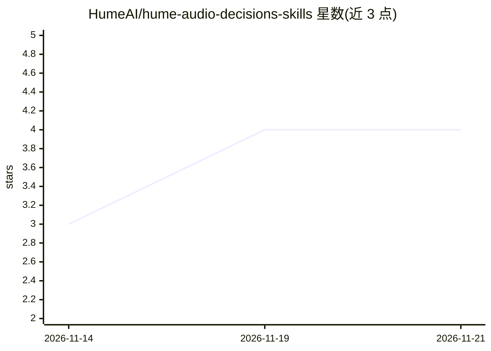

# HumeAI/hume-audio-decisions-skills

⭐ 4 · MIT · 推送 2026-11-09 · [GitHub](https://github.com/HumeAI/hume-audio-decisions-skills) · [官网](https://dev.hume.ai/audio-decisions/docs/for-coding-agents) · 组织维护

**供编码 agent 接入 Hume 音频问答 API 的官方技能包**

HumeAI 官方发布的 Agent Skills 技能包，让 Claude Code、Codex、Cursor 等编码 agent 学会使用 Audio Decisions API：判断问题是否适合该 API、选择音频覆盖范围、组织问题措辞、解析和校验以概率形式返回的答案。内容含文档、原语说明、解读指南、示例集、Python/TypeScript SDK 参考等，覆盖批量处理与实时音频。要求支持 Agent Skills 的编码 agent 与 HUME_API_KEY 环境变量。

## 筛选速览

| 维度 | 判定 | 备注 |
|---|---|---|
| AI 角色 | `ai-ecosystem` | LLM/agent 周边工具 |
| 许可风险 | `permissive` | MIT |
| 部署形态 | `library` | 以包/库形式分发 |
| 模型依赖 | — | README 未给出锁定关系 |
| 硬件要求 | — | 无带数字的原话,不猜 |
| 安装摩擦 | `medium` | 含编译或系统依赖之一 |
| 成熟度 | — | 结构信号不足 |

## 能力要点

- 面向 Claude Code、Codex、Cursor 等编码 agent 的官方 Audio Decisions API 技能
- 覆盖问题适用性判断、问题措辞、答案读取与校验全流程
- 支持批量录音、实时音频等场景
- 遵循 Agent Skills 规范，可复制到任意 agent 的技能目录使用

## 适用场景

- 让编码 agent 批量筛查客服录音中情绪不满的通话并输出 CSV
- 在 Web 应用中为演讲练习添加说话者自信度的实时指示
- 让 agent 评估某业务问题能否通过该音频 API 回答并给出替代问法

## 场景标签

`编码 Agent` · 领域:编码与开发

## 证据(README 行号)

> L3: Agent skills for the Audio Decisions API. The API answers questions about audio that you write in plain language. Se
> L5: The `audio-decisions-api` skill teaches coding agents such as Claude Code, Codex, and Cursor to build with the API: 
> L20: 2. A Hume API key, set as the `HUME_API_KEY` environment variable. See Authentication.

## 星数曲线

2026-11-14 3 → 2026-11-21 4（+1）

---
*卡片 v1 · prompt 1.4 · 生成 2026-11-21 · 置信度 high · 依据 README sha `dc28b249e5dc` · [字段定义](../../DATASET.md)*
