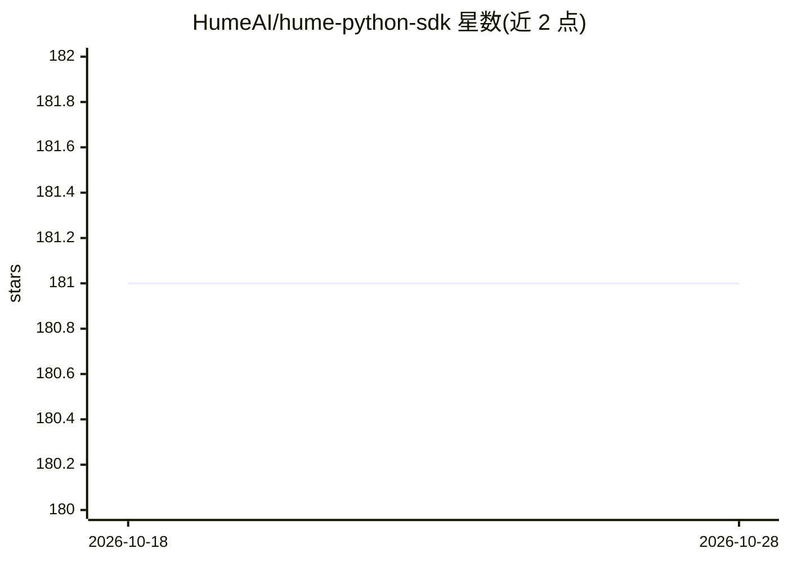

# HumeAI/hume-python-sdk

⭐ 181 · Python · MIT · 推送 2026-08-17 · [GitHub](https://github.com/HumeAI/hume-python-sdk) · [官网](https://dev.hume.ai) · 组织维护

**Hume AI API 的 Python 客户端 SDK：接入语音情感与 TTS**

Hume AI 官方 Python SDK，封装 Empathic Voice Interface（EVI）与 Text-to-speech 两组 API，供 Python 应用直接调用。提供同步与异步客户端、按 API 命名空间组织、WebSocket 客户端用于 EVI、自动分页、指数退避自动重试（408/409/429/5XX）、可配置超时与自定义 httpx 客户端。兼容 Python 3.9-3.13，EVI 支持 macOS/Linux，TTS 另支持 Windows。需 API key，经 pip/poetry/uv 安装。

## 筛选速览

| 维度 | 判定 | 备注 |
|---|---|---|
| AI 角色 | `ai-ecosystem` | LLM/agent 周边工具 |
| 许可风险 | `permissive` | MIT |
| 部署形态 | `library` | 以包/库形式分发 |
| 模型依赖 | — | README 未给出锁定关系 |
| 硬件要求 | — | 无带数字的原话,不猜 |
| 安装摩擦 | `low` | 无编译、无系统依赖或容器化 |
| 成熟度 | — | 结构信号不足 |

## 能力要点

- 同步与异步客户端，EVI 与 TTS 按命名空间组织
- EVI WebSocket 客户端，支持 intellisense/autocomplete
- 自动重试（指数退避）、分页生成器、可配置超时
- 可覆盖 httpx 客户端以支持代理与自定义传输

## 适用场景

- 在 Python 应用中集成 Hume 语音情感接口 EVI
- 在 Python 应用中调用 Hume 文本转语音
- 构建与 EVI 的 WebSocket 实时交互

## 场景标签

`语音合成` `语音 Agent` · 领域:对话与助手

## 证据(README 行号)

> L3:  Integrate Hume APIs directly into your Python application
> L67: This SDK contains the APIs for empathic voice and tts. Even
> L78: client.empathic_voice. # APIs specific to Empathic Voice

## 星数曲线

2026-10-18 181 → 2026-10-28 181（+0）

---
*卡片 v1 · prompt 1.4 · 生成 2026-10-22 · 置信度 high · 依据 README sha `b381dcb7e08c` · [字段定义](../../DATASET.md)*
