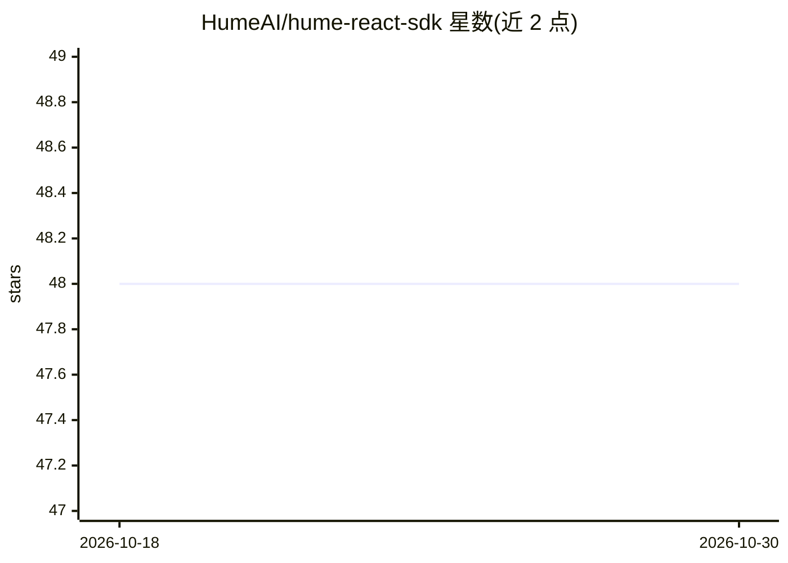

# HumeAI/hume-react-sdk

⭐ 48 · TypeScript · 推送 2026-08-18 · [GitHub](https://github.com/HumeAI/hume-react-sdk) · [官网](https://hume.ai) · 组织维护

**在 React 应用中接入 Hume AI 语音接口的 SDK 合集**

Hume AI 官方维护的 monorepo，提供三个 npm 包：@humeai/voice-react、voice-embed、voice-embed-react，用于在 React 应用中集成 Empathic Voice Interface（EVI）。另提供 EVI Next.js 一键部署模板；非 React 用户可改用其 TypeScript/Python SDK 或直接调用 API。本地开发基于 Turborepo，通过 pnpm install/dev 启动各 SDK 包与示例应用的开发服务器。包本身为客户端接入层，模型服务由 Hume AI 提供。

## 筛选速览

| 维度 | 判定 | 备注 |
|---|---|---|
| AI 角色 | `ai-ecosystem` | LLM/agent 周边工具 |
| 许可风险 | `none` | — |
| 部署形态 | `library` | 以包/库形式分发 |
| 模型依赖 | — | README 未给出锁定关系 |
| 硬件要求 | — | 无带数字的原话,不猜 |
| 安装摩擦 | `low` | 无编译、无系统依赖或容器化 |
| 成熟度 | — | 结构信号不足 |

## 能力要点

- 三个 npm 包支持 React 中的 EVI 集成
- 提供 EVI Next.js 一键部署启动模板
- 基于 Turborepo 的本地开发流程，含各包与示例应用

## 适用场景

- 在 React 应用中接入 Hume AI 的共情语音接口
- 用 Next.js 模板快速搭建 EVI 应用
- 本地开发与调试基于 Hume 语音的示例应用

## 场景标签

`语音 Agent` · 领域:对话与助手

## 证据(README 行号)

> L3:  Integrate Hume AI in your React application
> L7: This monorepo contains packages for adding Hume AI to your React applications.
> L11: |@humeai/voice-react|https://img.shields.io/npm/v/%40humeai%2Fvoice-react|README|<https://npmjs.com/package/@humeai

## 星数曲线

2026-10-18 48 → 2026-10-30 48（+0）

---
*卡片 v1 · prompt 1.4 · 生成 2026-10-25 · 置信度 high · 依据 README sha `025d4e8d42de` · [字段定义](../../DATASET.md)*
