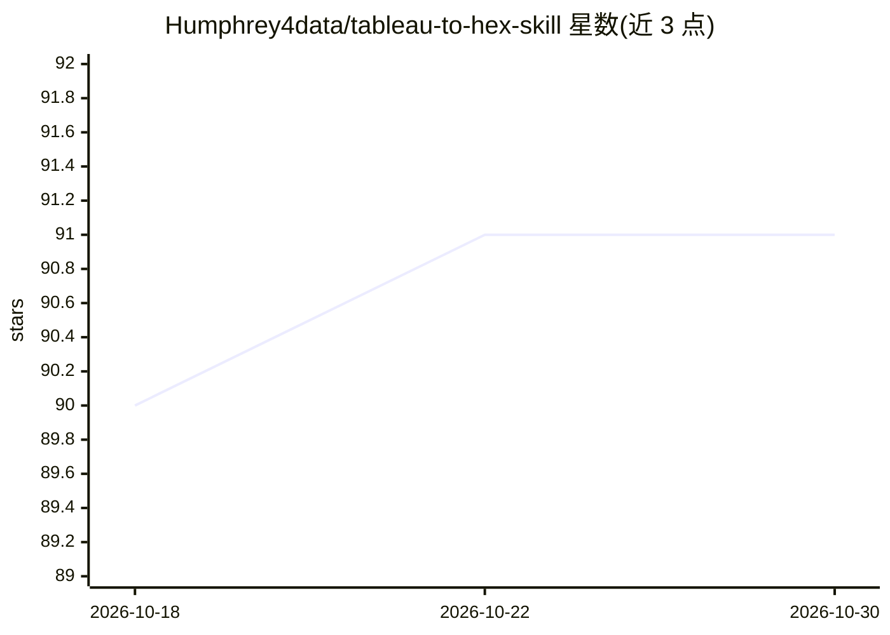

# Humphrey4data/tableau-to-hex-skill

⭐ 91 · MIT · 推送 2026-07-30 · [GitHub](https://github.com/Humphrey4data/tableau-to-hex-skill) · 个人维护

**将 Tableau/Looker/Power BI 仪表盘迁移到 Hex 的 agent 技能**

面向 Cursor、Claude Code、Codex 等 agent 框架的迁移技能：从源 BI 平台提取工作簿/报表定义（Tableau 工作簿 XML、Looker API、Power BI PBIR+TMDL），先对照数仓核验数字，再向 Hex agent 发送 SQL 与样式规格构建 Generative app，随后以无头截图逐面板比对源图，循环修复直至对齐，并输出含并排图像与逐面板对齐表的证据包。整个过程为多小时受监督任务，需人工提供凭据、tooltip 截图与最终签核。

## 筛选速览

| 维度 | 判定 | 备注 |
|---|---|---|
| AI 角色 | `ai-ecosystem` | LLM/agent 周边工具 |
| 许可风险 | `permissive` | MIT |
| 部署形态 | `None` |  |
| 模型依赖 | — | README 未给出锁定关系 |
| 硬件要求 | — | 无带数字的原话,不猜 |
| 安装摩擦 | `low` | 无编译、无系统依赖或容器化 |
| 成熟度 | — | 结构信号不足 |

## 能力要点

- 从 Tableau/Looker/Power BI API 提取 SQL、计算字段、筛选器、布局与颜色
- 构建前先在数仓重跑各部分逻辑并与源数字对账
- 无头截图逐面板 diff 的自动对齐循环
- 产物存于 ~/.tab2hex/ 支持中断续跑

## 适用场景

- 把现有 Tableau/Looker/Power BI 仪表盘迁移为 Hex 应用
- 迁移后自动核验数字、筛选器与视觉一致性
- 生成可交付的对齐证据包供人工签核

## 场景标签

`编码 Agent` `工作流自动化` · 领域:效率与自动化

## 证据(README 行号)

> L3: An agent skill that migrates a Tableau, Looker, or Power BI dashboard to a Hex app with **matching queries, numbers,
> L42: - **Cursor**: `.cursor/skills/tableau-to-hex-migration/` (project) or `~/.cursor/skills/...` (personal)
> L48: - **Hex workspace** with the CLI enabled and the **Hex agent (threads)** feature available — Phase 3 consumes works

## 星数曲线

2026-10-18 90 → 2026-10-30 91（+1）

---
*卡片 v1 · prompt 1.4 · 生成 2026-10-23 · 置信度 high · 依据 README sha `20fe89c4006b` · [字段定义](../../DATASET.md)*
