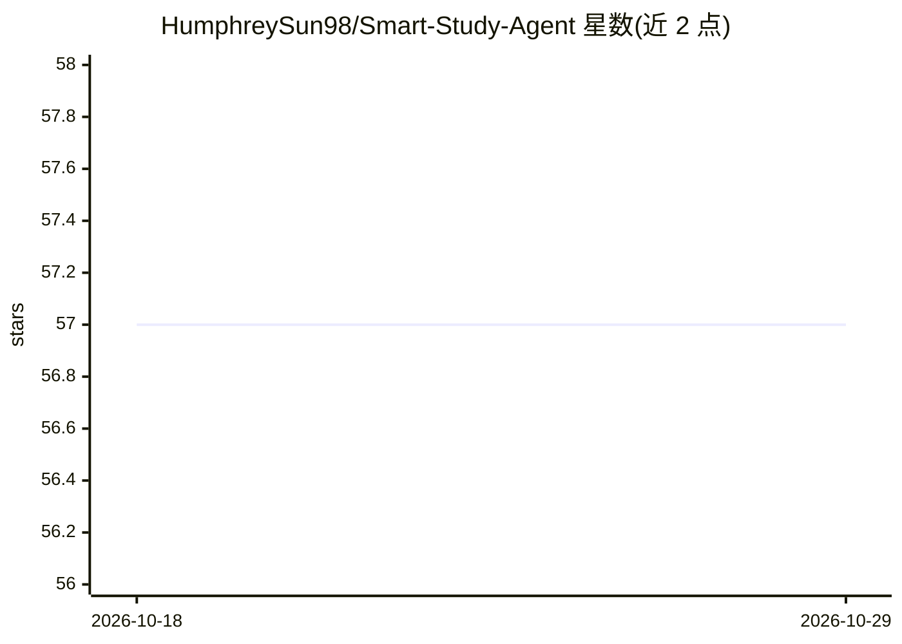

# HumphreySun98/Smart-Study-Agent

⭐ 57 · JavaScript · MIT · 推送 2026-08-16 · [GitHub](https://github.com/HumphreySun98/Smart-Study-Agent) · [官网](https://huggingface.co/spaces/HumphreySun98/smart-study-agent) · 个人维护 · 中文 README

**自适应学习 agent：RL 决定学什么、FSRS 排复习、LLM 出题**

面向学生与自学者的目标驱动型学习 agent：从 PDF/DOCX/PPTX/字幕等 7 种材料提取主题，构建概念依赖图；以 POMDP 建模学生知识状态，Q-learning（或 LinUCB bandit）在 review/reinforce/advance 三种动作间做决策，FSRS 间隔重复模型安排复习时间，LLM 负责生成测验并解释决策。支持 LLM 后端包括 Claude、HF Inference（Kimi-K2）及任意 OpenAI 兼容端点（Ollama/LM Studio/vLLM/DeepSeek），含 Mock 离线模式。交付形态有 Streamlit 网页、Chrome 扩展（MV3）、终端 UI、MCP server 与 Claude Agent Skill，可一键导出 Anki .apkg，数据存于 SQLite。

## 筛选速览

| 维度 | 判定 | 备注 |
|---|---|---|
| AI 角色 | `ai-native` | 本体是模型或模型工具 |
| 许可风险 | `permissive` | MIT |
| 部署形态 | `library` | 以包/库形式分发 |
| 模型依赖 | local-ok | 支持本地模型 |
| 硬件要求 | — | 无带数字的原话,不猜 |
| 安装摩擦 | `low` | 无编译、无系统依赖或容器化 |
| 成熟度 | — | 结构信号不足 |

## 能力要点

- POMDP 信念状态 + Q-learning 决定下一步学习动作，LLM 仅生成测验与解释
- FSRS 间隔重复（SM-2 回退），per-topic 记忆模型
- Chrome 扩展可在任意网页/PDF/YouTube 视频上运行完整 agent 循环
- 多后端：Claude、HF Inference（Kimi-K2 免费）、任意 OpenAI 兼容端点（Ollama/vLLM 等）、Mock 离线模式

## 适用场景

- 把讲义 PDF 转成个性化测验并跟踪薄弱知识点
- 通过 Claude Desktop/Code 的 MCP server 管理复习队列与出题
- 在浏览网页或看课程视频时边学边测
- 把生成的题库导出到 Anki 复习

## 场景标签

`文档解析` · 领域:知识与检索

## 证据(README 行号)

> L3: > The AI study agent that **learns how you learn** — a reinforcement-learning policy decides *what* you study next, 
> L36: SmartStudy Agent is a goal-based, partially observable AI agent that turns any lecture material into a fully person
> L87: - **Claude integration** with `thinking: {type: "adaptive"}` for internal reasoning

## 星数曲线

2026-10-18 57 → 2026-10-29 57（+0）

---
*卡片 v1 · prompt 1.4 · 生成 2026-10-24 · 置信度 high · 依据 README sha `978dfc06ed74` · [字段定义](../../DATASET.md)*
