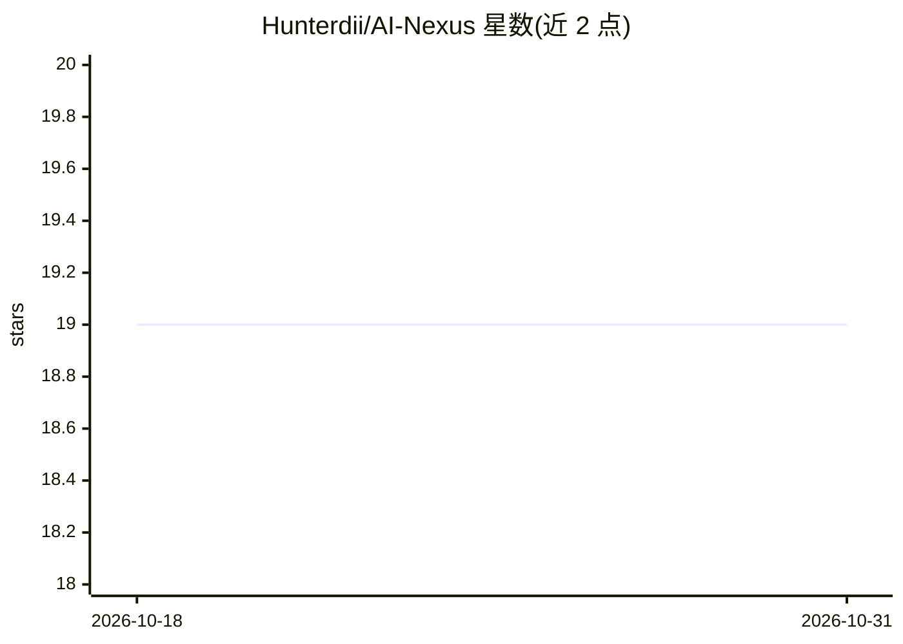

# Hunterdii/AI-Nexus

⭐ 19 · Jupyter Notebook · MIT · 推送 2026-04-12 · [GitHub](https://github.com/Hunterdii/AI-Nexus) · 个人维护

**6 个 Streamlit AI/ML 小应用的合集仓库**

以单一仓库聚合六个基于 Streamlit 的机器学习应用：GlycoTrack 糖尿病预测（KNN/随机森林/SVM 等多模型）、IrisWise 鸢尾花物种分类、GradeCast GPA 回归预测、DigitSense MNIST 手写数字识别（CNN）、StyleScan Fashion-MNIST 服装分类、ObjexVision CIFAR-10 物体识别。每个应用独立目录，含各自 requirements.txt，git clone 后 pip 安装依赖并 streamlit run 启动，浏览器访问 localhost:8501。README 提供各应用的 Streamlit 在线演示链接入口（表格占位）。

## 筛选速览

| 维度 | 判定 | 备注 |
|---|---|---|
| AI 角色 | `ai-native` | 本体是模型或模型工具 |
| 许可风险 | `permissive` | MIT |
| 部署形态 | `library` | 以包/库形式分发 |
| 模型依赖 | — | README 未给出锁定关系 |
| 硬件要求 | — | 无带数字的原话,不猜 |
| 安装摩擦 | `low` | 无编译、无系统依赖或容器化 |
| 成熟度 | — | 结构信号不足 |

## 能力要点

- 6 个独立 Streamlit 应用：图像分类、医疗预测、GPA 回归
- 分类任务覆盖 Fashion-MNIST/MNIST/CIFAR-10/Iris 四个数据集
- 每个应用可单独 clone 后 pip + streamlit run 本地运行

## 适用场景

- 在浏览器中试用各类经典机器学习分类与回归应用
- 作为入门级 ML 项目集合 fork 后修改 UI 或添加模型
- 通过在线演示快速查看各模型的预测效果

## 场景标签

`目标检测` · 领域:感知与多模态

## 证据(README 行号)

> L3: **AI Nexus** is a central repository that brings together a collection of advanced AI and ML applications. These pro
> L62: An intuitive app for predicting diabetes based on health metrics like Glucose, Blood Pressure, BMI, etc. It uses va

## 星数曲线

2026-10-18 19 → 2026-10-31 19（+0）

---
*卡片 v1 · prompt 1.4 · 生成 2026-10-29 · 置信度 mid · 依据 README sha `232d9af1f4a5` · [字段定义](../../DATASET.md)*
