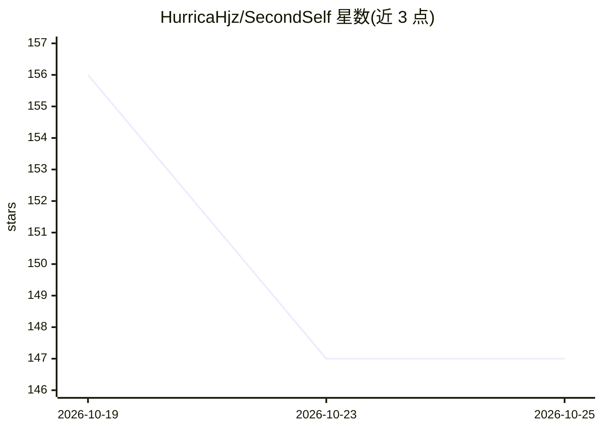

# HurricaHjz/SecondSelf

⭐ 147 · Python · MIT · 推送 2026-10-01 · [GitHub](https://github.com/HurricaHjz/SecondSelf) · 个人维护

**运行在 Obsidian 上的个人 AI 研究助理：多 agent + 本地 wiki 记忆**

以仓库中的技能、规则与配置构成的多 agent 框架：由 Claude Code 或 Obsidian 的 Claudian 插件驱动主 agent，GPT 模型经 Codex CLI 作为辅助 agent，将投入的 PDF/链接等来源编译为本地 Markdown wiki 并自行维护交叉链接与目录。提供 ingest/query/output/lint 等 13 个技能，回答均引用其知识页并带信任级别分级。当前形态为研究助理，Pre-1.0 迭代中，需自备 API 额度，无本地模型。

## 筛选速览

| 维度 | 判定 | 备注 |
|---|---|---|
| AI 角色 | `ai-native` | 本体是模型或模型工具 |
| 许可风险 | `permissive` | MIT |
| 部署形态 | `library` | 以包/库形式分发 |
| 模型依赖 | locked-api |  |
| 硬件要求 | — | 无带数字的原话,不猜 |
| 安装摩擦 | `low` | 无编译、无系统依赖或容器化 |
| 成熟度 | `idea` | |

## 能力要点

- 13 个技能覆盖摄入、问答、生成文档、wiki 校验与自维护
- 回答带引用，每条知识页标注分级信任级别
- 多 agent 分工：独立 critic/verifier agent 审查，辅助 agent 按书面契约限定写入范围
- 可选 qmd 本地语义搜索，小嵌入模型可在笔记本 CPU 上运行

## 适用场景

- 把论文、文章、链接整理成可被 AI 原生读取的个人知识库并问答
- 让一个记住自己资料积累的 agent 代写简报、报告等交付物
- 多人/多 agent 共享同一 wiki 作为团队知识底座

## 场景标签

`多智能体` `知识库管理` `科研工具` · 领域:Agent 开发

## 证据(README 行号)

> L13: Today Second Yourself runs in Claude Code or the Claudian plugin inside Obsidian, with GPT models as helper agents 
> L20: * **A research assistant**, what ships today: drop in papers and articles, ask questions, and get answers cited fro
> L50: * **Answers and generation:** The agent answers questions and creates almost any deliverable, from briefs and repor

## 星数曲线

2026-10-19 156 → 2026-10-25 147（-9）

---
*卡片 v1 · prompt 1.4 · 生成 2026-10-22 · 置信度 mid · 依据 README sha `e243696bd39f` · [字段定义](../../DATASET.md)*
