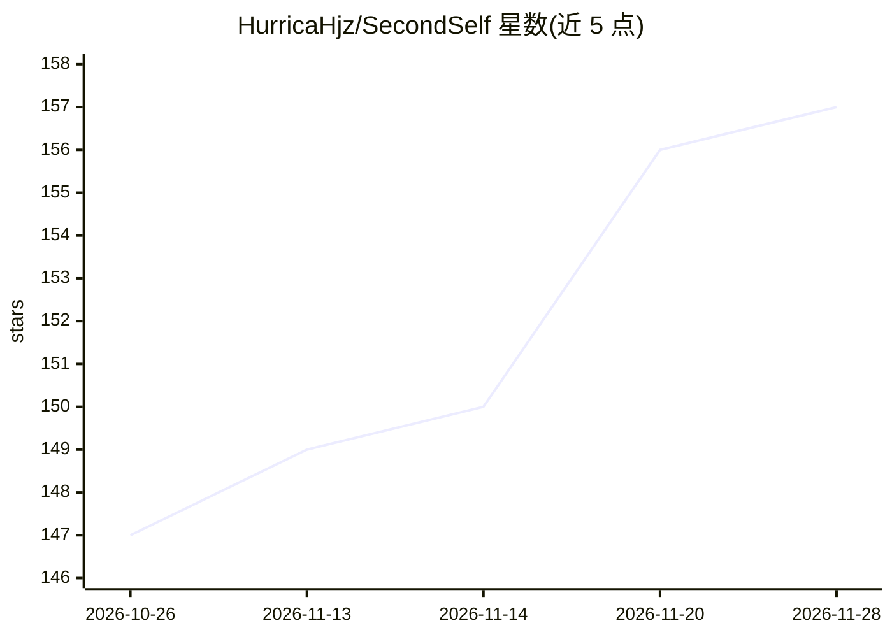

# HurricaHjz/SecondSelf

⭐ 157 · Python · MIT · 推送 2026-11-24 · [GitHub](https://github.com/HurricaHjz/SecondSelf) · [官网](https://hurricahjz.github.io/) · 个人维护

**为 AI 编码 agent 构建个人知识库与多 agent 协作框架**

以规则与技能文件夹形式分发的框架：克隆到本机后在 AI 编码 agent（Claude Code 或 Obsidian 的 Claudian 插件）中运行。用户把论文、网页等资料放入 raw/，/ingest 将其编译为带链接与置信度的 Markdown 笔记 wiki；/query 从 wiki 引用作答，/output 生成带引用文档，/lint 检查坏链与孤岛笔记。支持通过 Codex CLI 调度 GPT 子 agent，含 critic/verifier 校验 agent 与免值守长任务。推理在云端模型完成，需 Claude 付费账户，本地无需 GPU。

## 筛选速览

| 维度 | 判定 | 备注 |
|---|---|---|
| AI 角色 | `ai-native` | 本体是模型或模型工具 |
| 许可风险 | `permissive` | MIT |
| 部署形态 | `library` | 以包/库形式分发 |
| 模型依赖 | locked-api |  |
| 硬件要求 | — | 无带数字的原话,不猜 |
| 安装摩擦 | `low` | 无编译、无系统依赖或容器化 |
| 成熟度 | `idea` | |

## 能力要点

- /ingest 将来源编译为互链 Markdown 笔记，页面带来源与置信度标注
- /query 与 /output 产出带引用的回答与文档
- 15 个技能、9 个 agent 定义，含 critic/verifier 独立校验
- codex-lane.py 通过 Codex CLI 运行 GPT 子 agent

## 适用场景

- 把论文与网页整理成可问答、可引用的个人 wiki
- 交给 agent 长任务并收到按待办分类的报告
- 在 Obsidian 图谱中查看并维护知识网络

## 场景标签

`多智能体` `知识库管理` · 领域:Agent 开发

## 证据(README 行号)

> L13: **aiMyth (open-sourced as SecondSelf) builds your second self by giving your AI harness a "mind" of your own.** The
> L34: aiMyth comes as a folder of rules and skills that you clone onto your own computer and open in an AI coding agent. 
> L118: |`/ingest` compiles sources from `raw/` into linked Markdown notes in `wiki/`. Every source page names its raw fil

## 星数曲线

2026-10-26 147 → 2026-11-28 157（+10）

---
*卡片 v1 · prompt 1.4 · 生成 2026-11-27 · 置信度 mid · 依据 README sha `995a7d44185f` · [字段定义](../../DATASET.md)*
