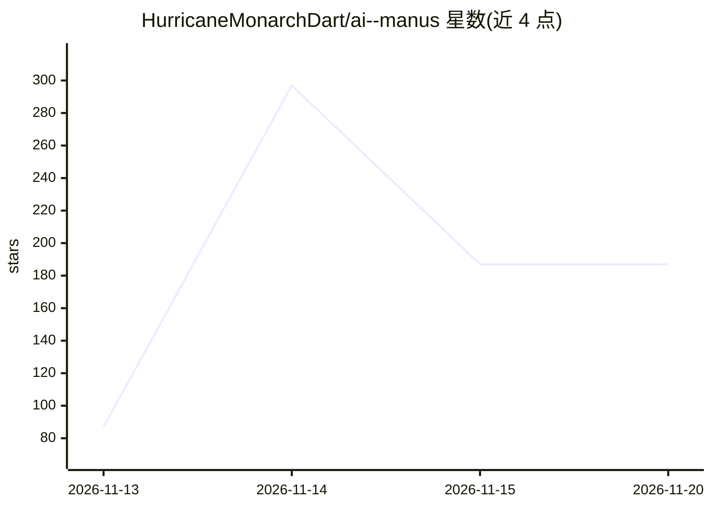

# HurricaneMonarchDart/ai--manus

⭐ 187 · Apache-2.0 · 推送 2026-11-15 · [GitHub](https://github.com/HurricaneMonarchDart/ai--manus) · 个人维护

**面向个人用户的自主 AI Agent：代为执行代码与浏览器操作**

README 描述一个自主 AI 代理，声称可自行编写并执行脚本、控制浏览器（导航网页、填表、采集信息）并完成多步骤任务，定位为家庭、学习与轻量办公场景的个人助手，而非企业平台。文中说明最小与推荐硬件配置（4GB/8GB 内存等）及六步上手流程（准备、配置、测试、细化、应用、维护）。但 README 未提供任何具体安装命令、代码仓库结构、模型接入方式或技术实现细节，仅有宣传性描述与下载提示，可验证的技术事实有限。

## 筛选速览

| 维度 | 判定 | 备注 |
|---|---|---|
| AI 角色 | `ai-native` | 本体是模型或模型工具 |
| 许可风险 | `permissive` | Apache-2.0 |
| 部署形态 | `None` |  |
| 模型依赖 | — | README 未给出锁定关系 |
| 硬件要求 | — | 无带数字的原话,不猜 |
| 安装摩擦 | `low` | 无编译、无系统依赖或容器化 |
| 成熟度 | — | 结构信号不足 |

## 能力要点

- 自主执行代码与控制浏览器完成多步骤任务
- 脚本执行与浏览器操作可在同一工作流中衔接
- 声明支持跨会话记住工作流模式

## 适用场景

- 让学生整理研究笔记、运行小脚本
- 代替人工完成网页查资料、填表等重复操作
- 日常小项目中委派耗时任务给后台代理

## 场景标签

`AI 助手` `浏览器自动化` `编码 Agent` · 领域:效率与自动化

## 证据(README 行号)

> L10: - **Autonomous Code Execution:** Manus AI agent runs code on its own to complete tasks, so you can focus on decisio
> L18: Manus is an autonomous AI agent designed to run code and control a browser on your behalf. Instead of acting like a

## 星数曲线

2026-11-13 87 → 2026-11-20 187（+100）

---
*卡片 v1 · prompt 1.4 · 生成 2026-11-17 · 置信度 low · 依据 README sha `a3d88e202bf0` · [字段定义](../../DATASET.md)*
