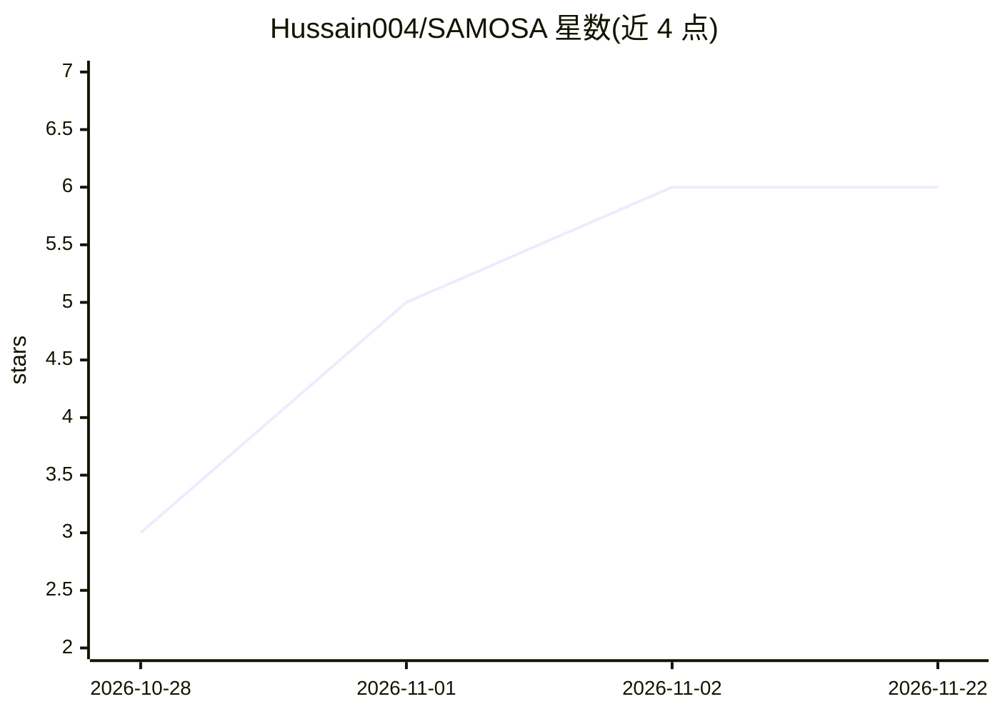

# Hussain004/SAMOSA

⭐ 6 · TypeScript · MIT · 推送 2026-11-18 · [GitHub](https://github.com/Hussain004/SAMOSA) · [官网](https://samosa-math.vercel.app) · 个人维护

**数学推导逐步校验器：逐步检查矩阵/随机/代数推导**

面向数学推导的 linter：粘贴 LaTeX align 块、Markdown 笔记或语言模型给出的答案，对每一行给出 holds/wrong/shape error/not checked 四种判定，错误行附带小反例与修正建议。核心机制是在有限域上采样矩阵并逐行求值，判定路径不含语言模型。提供 Web 应用、npm 安装的 CLI、GitHub Action、MCP server 与 Agent Skill，可在浏览器本地运行且不发出网络请求。限制：不证明定理，不检查不等式、极限与级数，解析器对部分记号不覆盖（自报 21.5% 展示行全解析）。

## 筛选速览

| 维度 | 判定 | 备注 |
|---|---|---|
| AI 角色 | `ai-enhanced` | 去掉 AI 部分产品仍成立 |
| 许可风险 | `permissive` | MIT |
| 部署形态 | `library` | 以包/库形式分发 |
| 模型依赖 | locked-api |  |
| 硬件要求 | — | 无带数字的原话,不猜 |
| 安装摩擦 | `low` | 无编译、无系统依赖或容器化 |
| 成熟度 | — | 结构信号不足 |

## 能力要点

- 在 GF(2³¹−1) 与 GF(2147483629) 上精确求值，给出漏检概率界
- 判定路径不含语言模型，仅算术与有限域
- 提供 Web、CLI、GitHub Action、MCP server、Agent Skill 五种使用形态
- 错误行输出缩小反例（NumPy 格式）与修正提示

## 适用场景

- 校验论文推导中"经代数操作可得"的关键一行
- 检查 Kalman 更新、梯度布局等常见推导错误
- 让 Claude Code/Codex/Cursor agent 自检其输出的数学步骤
- 在 CI 中 lint 论文的 align 公式块

## 场景标签

`模型评测` `科研工具` `教程课程` · 领域:评测与运维

## 证据(README 行号)

> L29: SAMOSA is a linter for math derivations. Paste a LaTeX `align` block, a
> L39: There is no language model in the verdict path. There is arithmetic, a finite
> L96: |**Your agent**|An MCP server and an Agent Skill, so Claude Code, Codex or Cursor can check their own math.|

## 星数曲线

2026-10-28 3 → 2026-11-22 6（+3）

---
*卡片 v1 · prompt 1.4 · 生成 2026-11-20 · 置信度 mid · 依据 README sha `19ce673903f3` · [字段定义](../../DATASET.md)*
