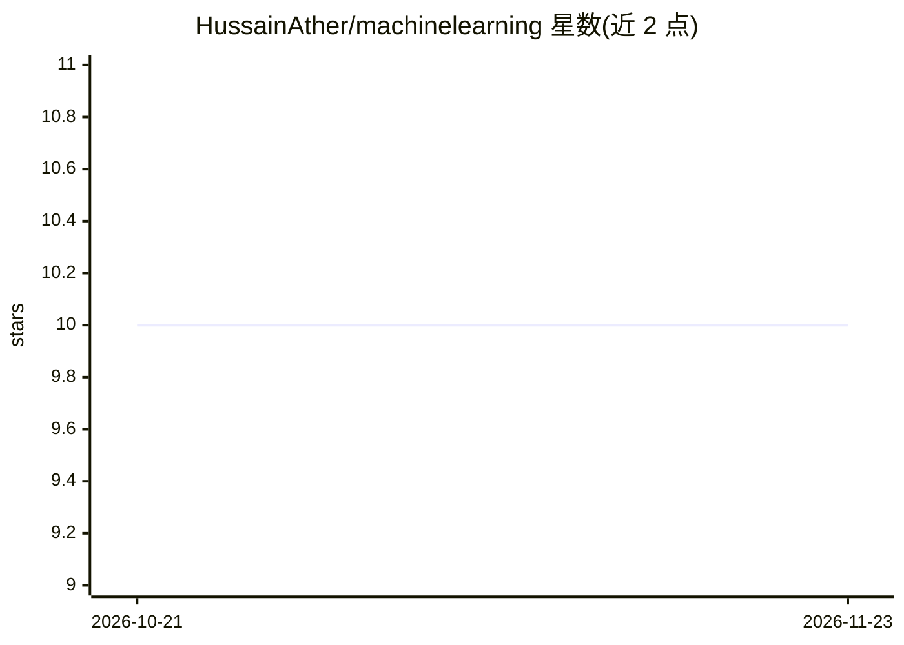

# HussainAther/machinelearning

⭐ 10 · Jupyter Notebook · 推送 2026-10-13 · [GitHub](https://github.com/HussainAther/machinelearning) · 个人维护

**机器学习课程的作业、笔记与示例代码目录**

以目录形式收录作者在 BIOF509 机器学习课程中的作业、笔记与解答，以及课程外的其他机器学习示例，内容涵盖聚类、回归、分类、深度学习、神经网络、探索性数据分析和特征选择等主题，使用 Python 编写。仓库还包含课程大纲（syllabus）供查阅。适合学习或参考课程式机器学习材料，未提供安装说明或可运行的成品工具。

## 筛选速览

| 维度 | 判定 | 备注 |
|---|---|---|
| AI 角色 | `ai-knowledge` | 知识聚合/清单类 |
| 许可风险 | `none` | — |
| 部署形态 | `None` |  |
| 模型依赖 | — | README 未给出锁定关系 |
| 硬件要求 | — | 无带数字的原话,不猜 |
| 安装摩擦 | `low` | 无编译、无系统依赖或容器化 |
| 成熟度 | — | 结构信号不足 |

## 能力要点

- 收录 BIOF509 课程的作业、笔记与解答
- 覆盖聚类、回归、分类、深度学习、神经网络等主题
- 包含探索性数据分析与特征选择示例
- 提供课程大纲（syllabus）

## 适用场景

- 跟读 BIOF509 课程时对照参考笔记与解答
- 学习聚类、回归、分类等经典机器学习方法的 Python 实现
- 查找探索性数据分析与特征选择的示例代码

## 场景标签

`教程课程` · 领域:学习与行业

## 证据(README 行号)

> L3: This is a general machine learning directory. It contains assignments, notes, and solutions from my machine learning

## 星数曲线

2026-10-21 10 → 2026-11-23 10（+0）

---
*卡片 v1 · prompt 1.4 · 生成 2026-11-20 · 置信度 mid · 依据 README sha `0a86d1b7d34e` · [字段定义](../../DATASET.md)*
