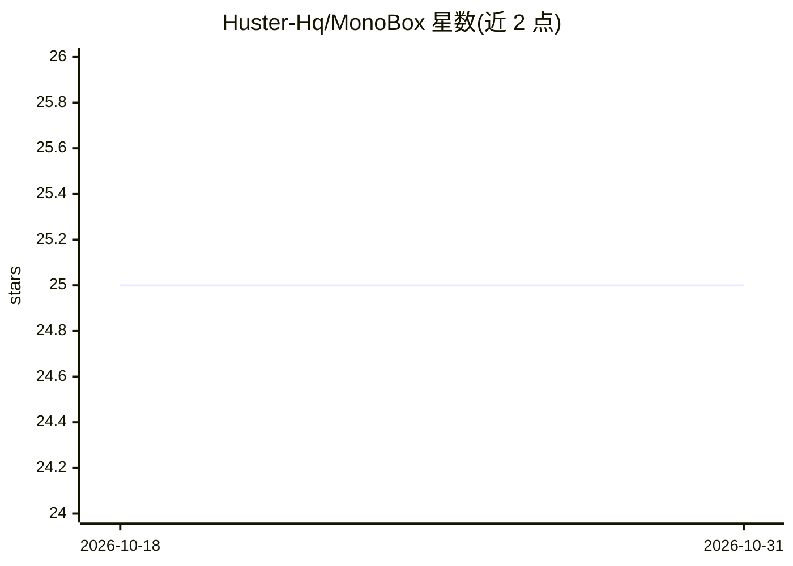

# Huster-Hq/MonoBox

⭐ 25 · Python · 推送 2025-12-05 · [GitHub](https://github.com/Huster-Hq/MonoBox) · [官网](https://arxiv.org/abs/2404.01188) · 组织维护

**AAAI 2025 框标注息肉分割方法：单调性约束容忍松框标注**

面向医学图像息肉分割的研究代码（AAAI 2025 论文 MonoBox 的 PyTorch 实现）。针对标注者疏忽与目标边缘模糊导致的不紧密框标注问题，提出单调性约束（MC）损失，替换任意 MIL 类框监督分割方法（如 BoxInst、BoxLevelSet、IBoxCLA）原有损失即可提升对松框的容忍度。提供训练/测试/评估脚本（Train.py、Test.py、eval.py）、预训练模型与合成噪声框标注（Google Drive 下载）。README 列明局限：小尺寸/细长物体与非连通（遮挡）物体会失败，但这类情况在结肠镜息肉图像中几乎不出现。

## 筛选速览

| 维度 | 判定 | 备注 |
|---|---|---|
| AI 角色 | `ai-native` | 本体是模型或模型工具 |
| 许可风险 | `none` | — |
| 部署形态 | `None` |  |
| 模型依赖 | — | README 未给出锁定关系 |
| 硬件要求 | — | 无带数字的原话,不猜 |
| 安装摩擦 | `low` | 无编译、无系统依赖或容器化 |
| 成熟度 | — | 结构信号不足 |

## 能力要点

- 单调性约束（MC）损失替换 MIL/投影/box-dice 损失即可接入
- 即插即用，适配任意 MIL 类框监督分割方法
- 提供预训练模型、合成噪声框标注与全部对比方法预测结果
- 评估指标覆盖 Dice、IoU、HD

## 适用场景

- 用松散框标注训练息肉分割模型
- 改进现有 MIL 框监督分割方法对非紧密框的容忍度
- 在 ClinicDB/Kvasir-SEG 等公开数据集上复现论文结果

## 场景标签

`目标检测` · 领域:感知与多模态

## 证据(README 行号)

> L11: We propose MonoBox, an innovative box-supervised segmentation method constrained by monotonicity to liberate its tr
> L16: Due to the carelessness of annotators and the blurred edges of target objects, the tightness-free box annotations a

## 星数曲线

2026-10-18 25 → 2026-10-31 25（+0）

---
*卡片 v1 · prompt 1.4 · 生成 2026-10-27 · 置信度 high · 依据 README sha `97a2d5763d9d` · [字段定义](../../DATASET.md)*
